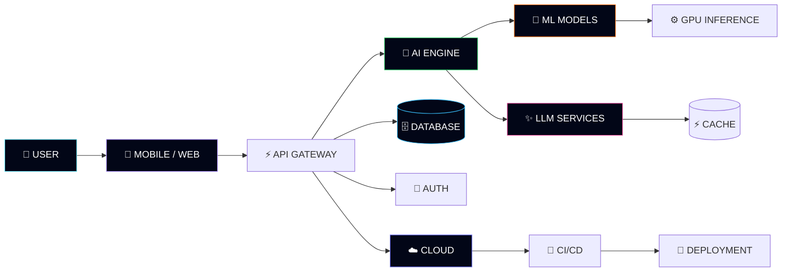

<div align="center">

<!-- ═══════════════════════════════════════════════════════════════════════ -->
<!--                    CINEMATIC AI HERO                                    -->
<!-- ═══════════════════════════════════════════════════════════════════════ -->

<a href="https://github.com/avinash9354">
  
</a>

<br/>


<br/><br/>

<a href="https://github.com/avinash9354">

</a>
&nbsp;
<a href="https://github.com/avinash9354?tab=followers">

</a>
&nbsp;


</div>

---

# `01` — SYSTEM PROFILE

<table>
<tr>
<td width="58%" valign="top">

```text
╭────────────────────────────────────────────────────╮
│                 AVINASH.OS v∞                      │
├────────────────────────────────────────────────────┤
│                                                    │
│  > identity.load()                                 │
│                                                    │
│  NAME       :: Avinash Pandey                     │
│  ROLE       :: AI / Software Engineer             │
│  DOMAIN     :: AI • iOS • Flutter • Full Stack    │
│  BASE       :: India 🇮🇳                           │
│                                                    │
│  > mission.execute()                               │
│                                                    │
│  Build intelligent products that solve             │
│  real problems — beautifully and efficiently.      │
│                                                    │
│  > current_state                                   │
│                                                    │
│  [███████████████████████░░░░░]  BUILDING         │
│                                                    │
╰────────────────────────────────────────────────────╯
```

</td>

<td width="42%" align="center">


<br/><br/>


</td>
</tr>
</table>

---

# `02` — ENGINEERING UNIVERSE

<div align="center">

### 🧬 CORE LANGUAGES


### 📱 APP ENGINEERING


### 🧠 AI / MACHINE LEARNING


### 🌐 FULL STACK


### ☁️ INFRASTRUCTURE & TOOLING


</div>

---

# `03` — WHAT I BUILD

<table>
<tr>

<td width="33%" valign="top">

### 🧠 AI SYSTEMS

```text
┌──────────────────────┐
│  INTELLIGENCE LAYER  │
├──────────────────────┤
│                      │
│  Neural Networks     │
│  Deep Learning       │
│  Computer Vision     │
│  Generative AI       │
│  LLM Applications    │
│  Model Optimization  │
│                      │
└──────────────────────┘
```

</td>

<td width="33%" valign="top">

### 📱 MOBILE SYSTEMS

```text
┌──────────────────────┐
│    APP EXPERIENCE    │
├──────────────────────┤
│                      │
│  SwiftUI             │
│  CoreML              │
│  iOS Architecture    │
│  Flutter             │
│  Firebase             │
│  Offline AI          │
│                      │
└──────────────────────┘
```

</td>

<td width="33%" valign="top">

### ⚙️ SOFTWARE SYSTEMS

```text
┌──────────────────────┐
│   ENGINEERING CORE   │
├──────────────────────┤
│                      │
│  APIs                │
│  Backend Systems     │
│  Databases           │
│  Cloud Architecture  │
│  CI/CD               │
│  Distributed Apps    │
│                      │
└──────────────────────┘
```

</td>

</tr>
</table>

---

# `04` — FLAGSHIP LAB

<div align="center">

### ✈️ FLIGHT BOOKING PLATFORM


**A modern, production-oriented flight booking experience**

`Search` → `Explore` → `Select` → `Passenger` → `Payment` → `Ticket`

---

### 🤖 AI CONVERSATIONAL PLATFORM


**Building conversational interfaces with intelligent workflows**

`Prompt` → `Context` → `Reasoning` → `Response` → `Memory`

---

### 🎨 ON-DEVICE AI PHOTO ENGINE


**AI-powered image restoration without depending on the cloud**

`Denoise` • `Enhance` • `Restore` • `Upscale` • `Inference`

---

### 🛰️ GENERATIVE AI + SATELLITE IMAGERY


**Researching intelligent reconstruction and enhancement pipelines**

`Satellite Data` → `Cloud Detection` → `Reconstruction` → `Enhancement`

</div>

---

# `05` — ARCHITECTURE MODE



---

# `06` — CURRENTLY LOADING...

<div align="center">

```text
AI ENGINEERING
██████████████████████████████████████░░  92%

DEEP LEARNING
██████████████████████████████████░░░░░░  84%

SWIFTUI
████████████████████████████████████░░░░  88%

COREML / ON-DEVICE AI
██████████████████████████████░░░░░░░░░░  76%

SYSTEM DESIGN
████████████████████████████░░░░░░░░░░░  72%

CLOUD / DEVOPS
██████████████████████████░░░░░░░░░░░░░  68%
```

</div>

---

# `07` — DEVELOPMENT MATRIX
