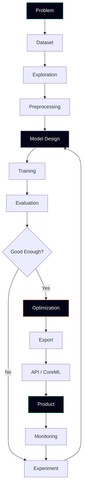
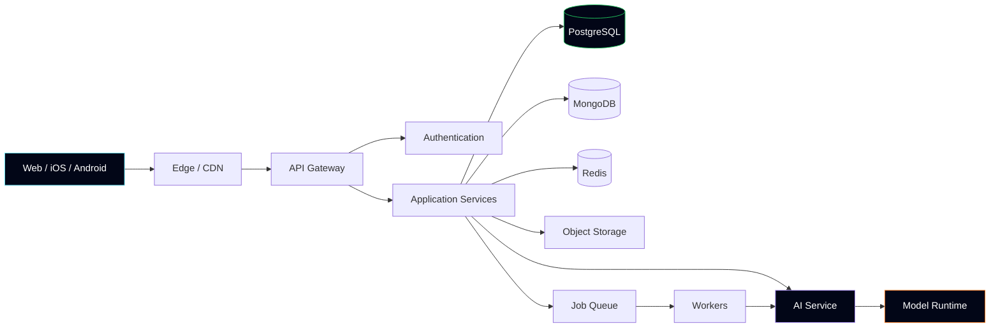
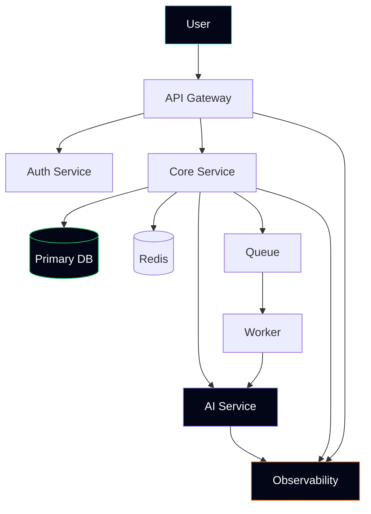
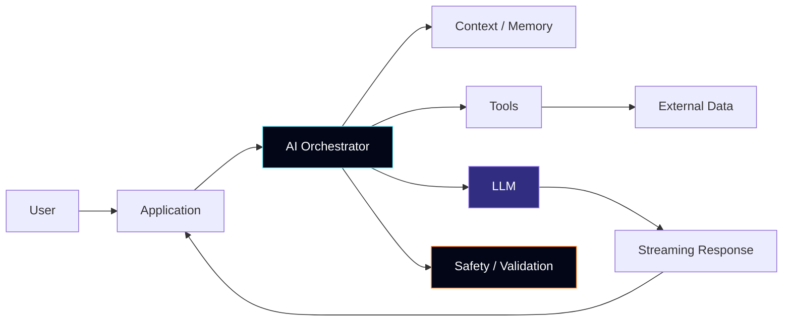

from pathlib import Path

readme = r'''<div align="center">

<!-- ============================================================= -->
<!--                     AVINASH PANDEY                            -->
<!--              CINEMATIC AI ENGINEERING PROFILE                 -->
<!-- ============================================================= -->


<br/>


<br/><br/>

> **"I don't just use technology. I build systems that make technology feel invisible."**

</div>

---

# 00 · `BOOT SEQUENCE`

```text
╔══════════════════════════════════════════════════════════════════════╗
║                        AVINASH.OS :: BOOT                            ║
╠══════════════════════════════════════════════════════════════════════╣
║                                                                      ║
║  [✓] Identity Kernel ..................................... ONLINE   ║
║  [✓] AI Research Engine .................................. ONLINE   ║
║  [✓] iOS Engineering Stack ............................... ONLINE   ║
║  [✓] Flutter Runtime ..................................... ONLINE   ║
║  [✓] Full-Stack Services .................................. ONLINE   ║
║  [✓] Product Architecture .................................. ONLINE  ║
║  [✓] Creative Engine ...................................... ONLINE   ║
║                                                                      ║
║  SYSTEM TARGET:                                                     ║
║                                                                      ║
║  Build → Ship → Measure → Learn → Rebuild → Scale                   ║
║                                                                      ║
║  CURRENT MISSION:                                                   ║
║  Turn ambitious ideas into intelligent, production-grade products. ║
║                                                                      ║
╚══════════════════════════════════════════════════════════════════════╝
```

---

# 01 · `IDENTITY`

<table>
<tr>
<td width="55%" valign="top">

## 👋 Hello, I'm Avinash

I'm an **AI-focused software engineer and product builder** interested in the intersection of:

- 🤖 Artificial Intelligence
- 🧠 Machine Learning
- 📱 iOS Engineering
- 🦋 Flutter Development
- 🌐 Full-Stack Systems
- 🏗️ Software Architecture
- ☁️ Cloud & Deployment
- 🎨 Product Experience
- 🔬 Applied Research

My goal is simple:

> **Take an idea from a blank screen to a real product.**

I enjoy working across the entire stack instead of living inside one layer.

</td>

<td width="45%" align="center">


<br/><br/>


</td>
</tr>
</table>

---

# 02 · `WHOAMI`

```yaml
profile:
  name: "Avinash Pandey"
  location: "India 🇮🇳"
  identity:
    - "AI Developer"
    - "iOS Developer"
    - "Flutter Developer"
    - "Full Stack Developer"
    - "ML Explorer"

mission:
  statement: >
    Build intelligent software products that solve meaningful problems
    while delivering exceptional user experiences.

interests:
  artificial_intelligence: true
  machine_learning: true
  mobile_engineering: true
  software_architecture: true
  product_engineering: true
  open_source: true

engineering_style:
  thinking: "systems-first"
  building: "prototype → validate → production"
  priority: "performance + reliability + experience"
  mindset: "learn by building"

current_mode:
  status: "BUILDING"
  energy: "HIGH"
  curiosity: "UNLIMITED"
```

---

# 03 · `ENGINEERING DNA`

<div align="center">

| DIMENSION | MY APPROACH |
|---|---|
| 🧠 Thinking | Systems over isolated features |
| 🔬 Learning | Build real projects |
| 🎨 Design | Simple, intentional interfaces |
| ⚡ Performance | Optimize where it matters |
| 🔐 Security | Design security into architecture |
| 🤖 AI | Useful intelligence over hype |
| 📱 Mobile | Native-quality experiences |
| 🌐 Web | Scalable and maintainable systems |
| 🧪 Testing | Validate assumptions early |
| 🚀 Shipping | Working software beats perfect plans |

</div>

---

# 04 · `THE TECHNOLOGY CONSTELLATION`

<div align="center">

### Languages


### Frontend


### Backend


### Mobile


### AI / ML


### Databases


### DevOps / Cloud


### Developer Tools


</div>

---

# 05 · `LANGUAGE MATRIX`

```text
┌─────────────────────────────────────────────────────────────────┐
│                    LANGUAGE ENGINEERING MAP                     │
├──────────────────────┬──────────────────────┬───────────────────┤
│ Swift                │ ██████████████████░░ │ Mobile            │
│ Python               │ ███████████████████░ │ AI / ML           │
│ TypeScript           │ █████████████████░░░ │ Full Stack        │
│ Dart                 │ ████████████████░░░░ │ Flutter           │
│ JavaScript           │ ████████████████░░░░ │ Web               │
│ Java                 │ █████████████░░░░░░░ │ Backend            │
│ C++                  │ ███████████░░░░░░░░░ │ Systems / DSA      │
│ C                    │ ██████████░░░░░░░░░░ │ Fundamentals       │
└──────────────────────┴──────────────────────┴───────────────────┘
```

---

# 06 · `AI LAB`

<div align="center">


</div>

## 🧠 Areas of Exploration

```text
                    ┌────────────────────┐
                    │    AI APPLICATION   │
                    └─────────┬──────────┘
                              │
          ┌───────────────────┼───────────────────┐
          ▼                   ▼                   ▼
   ┌─────────────┐     ┌─────────────┐     ┌─────────────┐
   │  GENERATIVE │     │ COMPUTER    │     │  PREDICTIVE │
   │     AI      │     │   VISION    │     │     ML      │
   └──────┬──────┘     └──────┬──────┘     └──────┬──────┘
          │                   │                   │
          ▼                   ▼                   ▼
       LLMs               CNNs              Regression
       Agents             Detection         Classification
       RAG                Restoration       Forecasting
       Prompting          Segmentation      Optimization
```

### Current AI Interests

- Neural network architectures
- Computer vision
- Image enhancement
- Generative AI
- LLM-powered applications
- On-device inference
- CoreML optimization
- Model compression
- AI product engineering
- Real-time inference pipelines

---

# 07 · `AI ENGINEERING PIPELINE`



---

# 08 · `MOBILE ENGINEERING`

## 🍎 iOS

My iOS engineering interests include:

- Swift
- SwiftUI
- UIKit
- CoreML
- Core Data
- Networking
- Concurrency
- MVVM
- Modular architecture
- App performance
- Accessibility
- Animation
- API integration

### iOS Philosophy

```text
UI
 ↓
Presentation
 ↓
Domain
 ↓
Data
 ↓
Infrastructure
 ↓
External Services
```

The objective:

> **Keep features independent, testable and scalable.**

---

# 09 · `FLUTTER ENGINEERING`

```text
Flutter Application
        │
        ├── Presentation
        │      ├── Widgets
        │      ├── Animations
        │      └── Themes
        │
        ├── State
        │      ├── Riverpod
        │      └── Reactive State
        │
        ├── Domain
        │      ├── Use Cases
        │      └── Entities
        │
        ├── Data
        │      ├── APIs
        │      ├── Firebase
        │      └── Local Storage
        │
        └── AI
               ├── On-device models
               ├── Image processing
               └── Intelligent features
```

---

# 10 · `FULL STACK ARCHITECTURE`



---

# 11 · `BACKEND MINDSET`

### API Design

```text
REQUEST
   ↓
Validation
   ↓
Authentication
   ↓
Authorization
   ↓
Business Logic
   ↓
Persistence
   ↓
Response
   ↓
Observability
```

### Backend Priorities

- predictable APIs
- strong validation
- clean error handling
- authentication
- authorization
- caching
- database indexing
- observability
- rate limiting
- graceful failures

---

# 12 · `DATABASE LAB`

<div align="center">

| DATABASE | USE CASE |
|---|---|
| PostgreSQL | Relational systems |
| MongoDB | Document-oriented systems |
| Firebase | Rapid product development |
| Redis | Cache / queues / fast state |
| MySQL | Relational workloads |

</div>

### Data Engineering Principle

```text
Fast queries are designed,
not hoped for.

Schema
  ↓
Indexes
  ↓
Query plan
  ↓
Cache
  ↓
Observability
```

---

# 13 · `DEVOPS ENGINE`

```text
Developer
    │
    ▼
Git Commit
    │
    ▼
Pull Request
    │
    ▼
Automated Checks
    │
    ├── Lint
    ├── Test
    ├── Build
    └── Security
    │
    ▼
Container
    │
    ▼
Deployment
    │
    ▼
Monitoring
```

### Tools

- Git
- GitHub
- GitHub Actions
- Docker
- Linux
- Vercel
- Render
- Cloud infrastructure
- CI/CD pipelines

---

# 14 · `PROJECT GALAXY`

## ✈️ Flight Booking iOS

**Category:** FinTech / Travel / Mobile

```text
SEARCH
  ↓
FLIGHTS
  ↓
FILTER
  ↓
DETAILS
  ↓
PASSENGERS
  ↓
PAYMENT
  ↓
CONFIRMATION
  ↓
TICKET
```

### Engineering Focus

- SwiftUI interface
- booking state management
- API integration
- payment architecture
- passenger data
- ticket generation
- error states
- loading states
- responsive UX

---

## 🤖 AI Conversational Application

**Category:** Generative AI

```text
USER
 ↓
PROMPT
 ↓
CONTEXT
 ↓
AI SERVICE
 ↓
MODEL
 ↓
STREAM
 ↓
UI
```

### Product Goals

- fast response rendering
- conversational UX
- streaming responses
- conversation history
- intelligent context
- clean mobile interface

---

## 🎨 AI Photo Editor

**Category:** Computer Vision

```text
PHOTO
 ↓
PREPROCESS
 ↓
MODEL
 ↓
INFERENCE
 ↓
POSTPROCESS
 ↓
RESULT
```

Potential capabilities:

- denoise
- enhancement
- restoration
- upscaling
- color improvement
- intelligent cropping
- on-device processing

---

## 🛰️ Satellite Image Reconstruction

**Category:** Generative AI / Earth Observation

```text
Satellite Image
       ↓
Cloud Detection
       ↓
Cloud Mask
       ↓
Context Extraction
       ↓
Reconstruction Model
       ↓
Enhancement
       ↓
Quality Evaluation
       ↓
Restored Image
```

---

# 15 · `PRODUCT ENGINEERING`

I don't think only in terms of features.

I think in terms of:

```text
Problem
 ↓
User
 ↓
Experience
 ↓
System
 ↓
Data
 ↓
AI
 ↓
Infrastructure
 ↓
Business
 ↓
Scale
```

A good product isn't only technically impressive.

It should also be:

- understandable
- reliable
- fast
- useful
- maintainable
- measurable

---

# 16 · `UI / UX ENGINE`

### Design Principles

```text
LESS NOISE
    ↓
CLEAR HIERARCHY
    ↓
FAST FEEDBACK
    ↓
INTENTIONAL MOTION
    ↓
ACCESSIBLE INTERACTION
```

### Animation Philosophy

Animation should communicate:

- state
- hierarchy
- transition
- feedback
- personality

Not simply exist because it can.

---

# 17 · `SYSTEM DESIGN`



---

# 18 · `SECURITY FIRST`

Security belongs inside the architecture.

### Security Checklist

```text
[✓] Authentication
[✓] Authorization
[✓] Input validation
[✓] Secret management
[✓] Encryption
[✓] Rate limiting
[✓] Secure storage
[✓] Dependency updates
[✓] Logging
[✓] Monitoring
[✓] Least privilege
```

---

# 19 · `PERFORMANCE LAB`

### Optimization Layers

```text
UI
 ↓
Network
 ↓
API
 ↓
Database
 ↓
Cache
 ↓
Compute
 ↓
Model
```

### Performance Questions

- What is the latency budget?
- What can be cached?
- What can be parallelized?
- What should be asynchronous?
- What belongs on-device?
- What belongs server-side?
- Where is the bottleneck?

---

# 20 · `AI + MOBILE`

One of my strongest interests is bringing AI closer to the user.

```text
                 AI PRODUCT
                     │
          ┌──────────┴──────────┐
          ▼                     ▼
      CLOUD AI             ON-DEVICE AI
          │                     │
      Powerful              Private
      Flexible              Fast
      Scalable              Offline
          │                     │
          └──────────┬──────────┘
                     ▼
                HYBRID SYSTEM
```

---

# 21 · `COREML LAB`

### Model Deployment Pipeline

```text
PyTorch / TensorFlow
        ↓
Model Validation
        ↓
Optimization
        ↓
Conversion
        ↓
CoreML
        ↓
iOS Integration
        ↓
Benchmark
        ↓
Production
```

Goals:

- lower latency
- lower memory usage
- better battery efficiency
- privacy
- offline inference

---

# 22 · `COMPUTER VISION`

Areas of interest:

| AREA | APPLICATION |
|---|---|
| Classification | Image understanding |
| Detection | Object localization |
| Segmentation | Pixel-level understanding |
| Restoration | Damaged image recovery |
| Enhancement | Visual quality |
| OCR | Text extraction |
| Tracking | Object movement |
| Transformation | Perspective / geometry |

---

# 23 · `MACHINE LEARNING WORKBENCH`

```text
Dataset
   │
   ├── Clean
   ├── Normalize
   ├── Augment
   └── Split
        │
        ▼
     Training
        │
        ├── Baseline
        ├── Experiment
        ├── Tune
        └── Validate
        │
        ▼
     Evaluation
        │
        ├── Accuracy
        ├── Precision
        ├── Recall
        ├── F1
        └── Latency
        │
        ▼
     Deployment
```

---

# 24 · `GENERATIVE AI`

### Application Architecture



---

# 25 · `OPEN SOURCE MINDSET`

Open source isn't just publishing code.

It is:

```text
Readable Code
     +
Useful Documentation
     +
Reproducible Setup
     +
Issues
     +
Discussions
     +
Community
     =
Healthy Project
```

---

# 26 · `GIT WORKFLOW`

```text
main
 │
 ├── feature/*
 │
 ├── fix/*
 │
 ├── refactor/*
 │
 └── experiment/*
        │
        ▼
      PR
        │
        ▼
   Review / CI
        │
        ▼
     Merge
        │
        ▼
      Release
```

---

# 27 · `CODE QUALITY`

### I care about

- readability
- naming
- separation of concerns
- error handling
- testability
- documentation
- predictable behavior
- performance
- maintainability

### Rule

> If future-me cannot understand it, present-me needs to refactor it.

---

# 28 · `RESEARCH MODE`

Research questions I like:

```text
Can AI run efficiently on-device?

How can models become smaller without losing quality?

How can computer vision solve real-world problems?

How can mobile apps use AI without feeling slow?

How should AI systems handle context?

How can intelligent systems become simpler for users?
```

---

# 29 · `LEARNING ENGINE`

```text
           CURIOUS
              │
              ▼
           QUESTION
              │
              ▼
           RESEARCH
              │
              ▼
           PROTOTYPE
              │
              ▼
           FAILURE
              │
              ▼
           LEARNING
              │
              ▼
           IMPROVEMENT
              │
              ▼
           PRODUCT
              │
              └──────────────► CURIOUS
```

---

# 30 · `CURRENTLY LEVELING UP`

<div align="center">


</div>

---

# 31 · `SKILL RADAR`

```text
AI / ML              ████████████████████░  92%
Python               ███████████████████░░  88%
Swift / SwiftUI      ██████████████████░░░  86%
Flutter              █████████████████░░░░  82%
Full Stack           █████████████████░░░░  82%
Backend              ████████████████░░░░░  78%
Computer Vision      ████████████████░░░░░  78%
System Design        ██████████████░░░░░░░  70%
DevOps               █████████████░░░░░░░░  66%
```

---

# 32 · `TOOLBOX`

<div align="center">


</div>

---

# 33 · `ARCHITECTURE PRINCIPLES`

```text
01  Keep boundaries clear.
02  Make dependencies explicit.
03  Prefer boring infrastructure when possible.
04  Measure before optimizing.
05  Design failure states.
06  Treat security as a feature.
07  Keep AI observable.
08  Make systems replaceable.
09  Automate repetitive work.
10  Build for the next engineer too.
```

---

# 34 · `PRODUCT DEVELOPMENT LOOP`


---

# 35 · `PROJECT BLUEPRINT`

Every serious project starts with:

```text
┌──────────────────────────────────────────┐
│               PROJECT                    │
├──────────────────────────────────────────┤
│ Problem                                  │
│ User                                     │
│ Value Proposition                        │
│ Architecture                             │
│ Technology                               │
│ Data                                     │
│ Security                                 │
│ AI / Automation                          │
│ UX                                       │
│ Testing                                  │
│ Deployment                               │
│ Monitoring                               │
│ Scale                                    │
└──────────────────────────────────────────┘
```

---

# 36 · `FLAGSHIP PROJECT CARDS`

## 🚀 Orbix Ecosystem

An ambitious technology ecosystem exploring:

- intelligent software
- browser experiences
- secure operating environments
- AI-assisted workflows
- developer tooling
- scalable infrastructure

---

## 🌌 SkyAI

A concept around AI-powered travel and intelligent trip experiences.

Potential layers:

```text
Travel Search
     ↓
Recommendation Engine
     ↓
AI Assistant
     ↓
Itinerary
     ↓
Booking
     ↓
Payments
     ↓
Post-Trip Intelligence
```

---

## 💬 AI Assistant Platforms

Focus:

- conversational UI
- context
- tool calling
- memory
- personalization
- multimodal interaction
- streaming
- intelligent workflows

---

## 🛰️ Satellite AI

Research direction:

```text
Remote Sensing
     +
Computer Vision
     +
Generative Models
     =
Intelligent Earth Observation
```

---

# 37 · `APP ARCHITECTURE PATTERN`

```text
┌──────────────────────────────┐
│            UI                │
├──────────────────────────────┤
│         View Model           │
├──────────────────────────────┤
│          Domain              │
├──────────────────────────────┤
│           Data               │
├──────────────────────────────┤
│       Infrastructure         │
└──────────────────────────────┘
```

Benefits:

- easier testing
- cleaner features
- replaceable APIs
- maintainable code
- scalable teams

---

# 38 · `API ENGINEERING`

### Request lifecycle

```text
HTTP Request
    ↓
Router
    ↓
Middleware
    ↓
Validation
    ↓
Controller
    ↓
Service
    ↓
Repository
    ↓
Database
    ↓
Serializer
    ↓
HTTP Response
```

---

# 39 · `OBSERVABILITY`

A production system should answer:

```text
What happened?
When did it happen?
Where did it happen?
Why did it happen?
How many users were affected?
How long did it take?
Did it recover?
```

Observability:

- logs
- metrics
- traces
- alerts
- dashboards

---

# 40 · `SCALABILITY`

```text
1 USER
   ↓
10 USERS
   ↓
1K USERS
   ↓
100K USERS
   ↓
1M USERS
```

The architecture must evolve.

### Scale levers

- caching
- queues
- horizontal scaling
- database indexes
- read replicas
- asynchronous processing
- CDN
- model optimization
- load balancing

---

# 41 · `AI SCALABILITY`

```text
MODEL
 ↓
OPTIMIZATION
 ↓
BATCHING
 ↓
CACHING
 ↓
QUEUE
 ↓
WORKERS
 ↓
GPU POOL
 ↓
AUTOSCALING
```

---

# 42 · `MOBILE PERFORMANCE`

### Performance targets

```text
Fast launch
     ↓
Smooth navigation
     ↓
Efficient rendering
     ↓
Minimal network waits
     ↓
Smart caching
     ↓
Efficient AI inference
     ↓
Battery awareness
```

---

# 43 · `DESIGN SYSTEM`

### UI tokens

```text
COLOR
├── Background
├── Surface
├── Primary
├── Accent
└── Danger

TYPE
├── Display
├── Heading
├── Body
└── Caption

MOTION
├── Enter
├── Exit
├── Transition
└── Feedback

SPACING
├── XS
├── SM
├── MD
├── LG
└── XL
```

---

# 44 · `ANIMATION LAB`

Animations I like:

- spring transitions
- staggered entrance
- shared-element motion
- scroll-based motion
- particle effects
- subtle parallax
- loading skeletons
- state transitions
- micro-interactions

Rule:

> **Motion should explain what changed.**

---

# 45 · `GITHUB TELEMETRY`

<div align="center">


<br/><br/>


</div>

---

# 46 · `CONTRIBUTION ENGINE`

<div align="center">


</div>

---

# 47 · `LANGUAGE TELEMETRY`

<div align="center">


</div>

---

# 48 · `CODING PHILOSOPHY`

```text
┌──────────────────────────────────────────────────────────────┐
│                                                              │
│  CODE SHOULD BE                                               │
│                                                              │
│       SIMPLE                                                  │
│         ↓                                                    │
│       READABLE                                                │
│         ↓                                                    │
│       TESTABLE                                                │
│         ↓                                                    │
│       OBSERVABLE                                              │
│         ↓                                                    │
│       SCALABLE                                                │
│                                                              │
└──────────────────────────────────────────────────────────────┘
```

---

# 49 · `FAILURE PHILOSOPHY`

Failure isn't the opposite of progress.

```text
TRY
 ↓
FAIL
 ↓
OBSERVE
 ↓
UNDERSTAND
 ↓
CHANGE
 ↓
TRY AGAIN
```

Every failed prototype is information.

---

# 50 · `LEARNING STACK`

```text
FOUNDATION
├── Mathematics
├── Algorithms
├── Data Structures
└── Computer Science

ENGINEERING
├── Architecture
├── APIs
├── Databases
├── Networking
└── Security

INTELLIGENCE
├── Machine Learning
├── Deep Learning
├── Computer Vision
├── Generative AI
└── Model Deployment

PRODUCT
├── UX
├── Design
├── Analytics
├── Growth
└── Business
```

---

# 51 · `ROADMAP`

## Phase I — Foundation

- strengthen CS fundamentals
- algorithms
- system design
- software architecture
- advanced programming

## Phase II — AI

- deep learning
- computer vision
- generative AI
- model deployment
- on-device inference

## Phase III — Product

- intelligent mobile apps
- AI assistants
- computer vision products
- scalable backend systems

## Phase IV — Infrastructure

- distributed systems
- cloud architecture
- GPU infrastructure
- observability
- high-scale systems

## Phase V — Innovation

- original research
- open-source projects
- new product ideas
- large-scale AI systems

---

# 52 · `2026 → FUTURE`

```text
2026
 │
 ├── AI Applications
 ├── Advanced iOS
 ├── Flutter
 ├── ML Systems
 └── Product Engineering
       │
       ▼
2027
 │
 ├── Advanced AI
 ├── System Design
 ├── Cloud
 ├── Research
 └── Large-scale products
       │
       ▼
2030+
 │
 └── Build technology that changes industries.
```

---

# 53 · `WHAT I'M BUILDING TOWARD`

### 🎯 Long-Term Vision

```text
AI
 +
SOFTWARE ENGINEERING
 +
PRODUCT DESIGN
 +
SYSTEM ARCHITECTURE
 +
RESEARCH
 =
TECHNOLOGY PRODUCTS
```

The destination isn't a specific programming language.

The destination is:

> **Being able to take a difficult problem and build the entire solution.**

---

# 54 · `ENGINEERING CHECKLIST`

Before shipping:

```text
[ ] Does the feature solve the actual problem?
[ ] Is the UX understandable?
[ ] Are loading states handled?
[ ] Are errors handled?
[ ] Is the data secure?
[ ] Is the API reliable?
[ ] Is the database indexed?
[ ] Is performance acceptable?
[ ] Is the system observable?
[ ] Can another engineer maintain it?
[ ] Can it scale?
[ ] Can it be tested?
```

---

# 55 · `AI PRODUCT CHECKLIST`

```text
[ ] Model quality
[ ] Latency
[ ] Cost
[ ] Privacy
[ ] Hallucination handling
[ ] Context management
[ ] Prompt robustness
[ ] Evaluation
[ ] Monitoring
[ ] Fallback behavior
[ ] User feedback
[ ] Continuous improvement
```

---

# 56 · `WHY I BUILD`

I like the moment when:

```text
       IDEA
        │
        ▼
     NOTHING
        │
        ▼
      CODE
        │
        ▼
    PROTOTYPE
        │
        ▼
     PRODUCT
        │
        ▼
      USERS
        │
        ▼
      IMPACT
```

That transformation is what keeps me building.

---

# 57 · `BEYOND CODE`

Technology is not only about writing code.

It is also about:

- asking better questions
- understanding users
- designing systems
- communicating ideas
- making trade-offs
- learning from failure
- thinking long-term

---

# 58 · `COLLABORATION`

I enjoy collaborating around:

```text
AI
├── Applied ML
├── Generative AI
└── Computer Vision

Mobile
├── iOS
└── Flutter

Engineering
├── Backend
├── Cloud
└── Architecture

Products
├── Startups
├── Experiments
└── Open Source
```

---

# 59 · `OPEN SOURCE MISSION`

```text
BUILD
 ↓
DOCUMENT
 ↓
SHARE
 ↓
GET FEEDBACK
 ↓
IMPROVE
 ↓
HELP OTHERS
 ↓
BUILD AGAIN
```

---

# 60 · `PROFILE COMMAND CENTER`

<div align="center">

| COMMAND | PURPOSE |
|---|---|
| 🧠 AI | Artificial Intelligence |
| 📱 MOBILE | iOS + Flutter |
| 🌐 WEB | Full Stack |
| ⚙️ SYSTEMS | Architecture |
| 🔬 LAB | Research |
| 🚀 PRODUCTS | Product Engineering |
| ☁️ CLOUD | Infrastructure |
| 🛠️ TOOLS | Developer Workflow |

</div>

---

# 61 · `CURRENT PROJECT RADAR`

```text
                         ┌───────────────┐
                         │   AI APPS     │
                         └───────┬───────┘
                                 │
             ┌───────────────────┼──────────────────┐
             ▼                   ▼                  ▼
       ┌───────────┐       ┌───────────┐      ┌───────────┐
       │   iOS     │       │   FLUTTER │      │   WEB     │
       └─────┬─────┘       └─────┬─────┘      └─────┬─────┘
             │                   │                  │
             └───────────────────┼──────────────────┘
                                 ▼
                         ┌───────────────┐
                         │   AI CORE     │
                         └───────────────┘
```

---

# 62 · `ENGINEERING VALUES`

### Curiosity

Never stop asking why.

### Ownership

If I build it, I understand it.

### Simplicity

Complex systems should feel simple to users.

### Reliability

A feature isn't finished until failure is considered.

### Growth

Every project should teach something.

### Impact

Technology matters when people can use it.

---

# 63 · `TERMINAL`

```bash
$ whoami
avinash-pandey

$ focus
AI + Software Engineering

$ stack
Swift Python Dart TypeScript Java React Node Flutter PyTorch

$ mission
Build intelligent products.

$ status
██████████████████████████████████████ ONLINE

$ next
Create something impossible.
```

---

# 64 · `SIGNAL`

<div align="center">


</div>

---

# 65 · `CONNECT`

<div align="center">

<a href="https://github.com/avinash9354">

</a>

<a href="https://www.linkedin.com/in/avinashpandeyai/">

</a>

<a href="https://www.instagram.com/mr.avi_pandey/">

</a>

<a href="mailto:avinash9354@email.com">

</a>

<br/><br/>


</div>

---

# 66 · `FINAL MESSAGE`

<div align="center">

```text
╔══════════════════════════════════════════════════════════════╗
║                                                              ║
║                    KEEP BUILDING.                            ║
║                                                              ║
║             KEEP LEARNING.                                   ║
║                                                              ║
║             KEEP QUESTIONING.                                ║
║                                                              ║
║             KEEP CREATING.                                   ║
║                                                              ║
║       The future belongs to people who build it.             ║
║                                                              ║
╚══════════════════════════════════════════════════════════════╝
```

<br/>

### ⚡ AI · MOBILE · SOFTWARE · SYSTEMS · INNOVATION

**Built with curiosity. Engineered with purpose.**

</div>

---

<div align="center">


</div>
'''

path = Path("/mnt/data/README.md")
path.write_text(readme, encoding="utf-8")

print(f"Created {path}")
print(f"Characters: {len(readme):,}")
print(f"Lines: {len(readme.splitlines()):,}")
print(f"Sections: {sum(1 for line in readme.splitlines() if line.startswith('# '))}")
