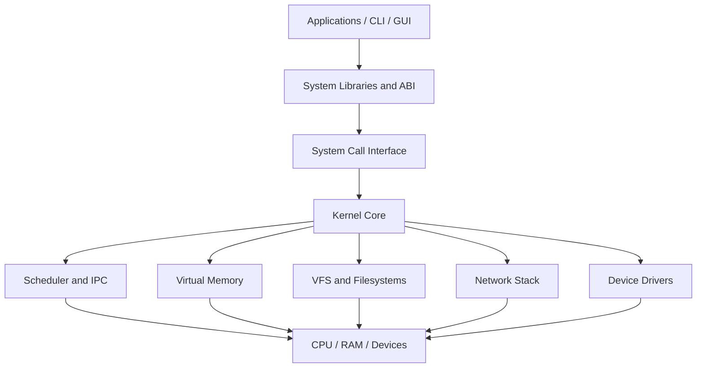
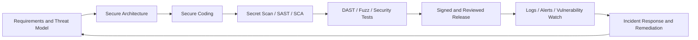
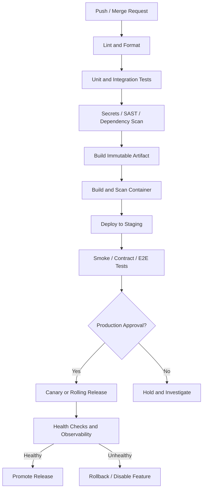

from pathlib import Path
import re

source = Path("/mnt/data/Pasted text(20261020-180703).txt")
raw = source.read_text(encoding="utf-8")

match = re.search(r"readme\s*=\s*r'''(.*?)'''\s*\n", raw, flags=re.S)
if not match:
    raise ValueError("Could not safely extract the README content from the supplied file.")

readme = match.group(1).strip()

# Add comprehensive engineering sections before the closing profile message.
insert_at = readme.find("# 66 · `FINAL MESSAGE`")
if insert_at == -1:
    insert_at = len(readme)

extra = r'''
---

# 66 · `OPERATING SYSTEM ENGINEERING`

<div align="center">


</div>

Operating-system engineering spans hardware interfaces, privileged execution, memory, scheduling, storage, security boundaries, and user-space services. This section maps the technologies and concepts I study and use when building systems-oriented projects.

### OS development stack

| Layer | Concepts and technologies |
|---|---|
| Boot process | BIOS/UEFI, bootloaders, GRUB, UEFI applications, boot protocols |
| Kernel foundations | C, C++, Rust, assembly (x86-64, ARM64), linker scripts, cross-compilers |
| CPU and interrupts | privilege rings, exceptions, interrupt descriptor tables, APIC, context switching |
| Memory management | virtual memory, paging, page tables, allocators, heaps, memory-mapped I/O |
| Processes and threads | scheduling, context switches, synchronization, IPC, signals, system calls |
| Drivers | PCI/PCIe, USB, storage, input, display, network interfaces, device trees |
| Storage and filesystems | block devices, VFS, FAT, ext-family concepts, journaling, permissions |
| Networking | Ethernet, sockets, TCP/IP, routing, packet buffers, network drivers |
| User space | C runtime, shell, utilities, daemons, init systems, service management |
| Build and debug | Make, CMake, Ninja, LLVM/Clang, GCC, GDB, LLDB, QEMU, Bochs |
| Testing | unit tests, integration tests, kernel tests, emulation, fuzzing, crash dumps |
| Virtualization | QEMU/KVM, Hyper-V concepts, VirtualBox, containers, hardware-assisted virtualization |

### OS architecture map



### Advanced OS topics

- Kernel/user-mode isolation, syscall ABI design, capabilities, permissions and privilege separation
- SMP and multicore scheduling, locks, atomics, race conditions, deadlocks and memory ordering
- Page faults, copy-on-write, memory-mapped files, shared memory and allocator design
- Interrupt handling, DMA, IOMMU concepts, device discovery and driver lifecycle
- Secure boot, measured boot, kernel hardening, signed modules and trusted update paths
- Containers, namespaces, cgroups, seccomp, virtual machines and hypervisor boundaries
- Crash analysis, core dumps, tracing, profiling, reproducible builds and supply-chain integrity

> **Project direction:** Build a small educational kernel in an emulator, document the boot-to-shell path, add memory management and a basic scheduler incrementally, and publish tests and architecture notes. A project is evidence of skill; a technology list alone is not.

---

# 67 · `CYBERSECURITY & SECURITY ENGINEERING`

<div align="center">


</div>

Security is a lifecycle: threat-model, prevent, detect, respond, recover, and learn. The focus is authorized testing, defensive engineering, and responsible disclosure.

### Security domains and tooling

| Domain | Concepts / tools to learn and apply |
|---|---|
| Security foundations | CIA triad, threat modeling, attack surface, risk, least privilege, zero trust |
| Application security | OWASP Top 10, ASVS, secure coding, output encoding, input validation |
| API security | OAuth 2.0, OpenID Connect, JWT validation, scopes, object-level authorization, rate limits |
| Identity and access | MFA, passkeys, RBAC, ABAC, IAM, PAM, session security, secrets rotation |
| Network defense | firewalls, segmentation, VPN, IDS/IPS, DNS security, TLS, packet analysis |
| Web testing | OWASP ZAP, Burp Suite Community, browser devtools, safe test environments |
| Vulnerability management | CVE, CVSS, patch prioritization, dependency inventory, remediation verification |
| Static and dynamic analysis | Semgrep, CodeQL, SAST, DAST, IAST concepts, fuzzing, secure code review |
| Dependency / supply chain | SBOM, SCA, signed artifacts, provenance, lockfiles, pinned actions and images |
| Endpoint / host defense | hardening, EDR concepts, audit logs, file integrity, patching, secure baselines |
| Cloud security | IAM policies, private networking, KMS, secret managers, workload identity, posture management |
| Containers and Kubernetes | image scanning, admission policies, RBAC, network policies, runtime restrictions |
| Detection and response | SIEM concepts, alert triage, incident timelines, containment, eradication, recovery |
| Digital forensics | evidence handling, chain of custody, disk and memory artifacts, log correlation |
| Cryptography | hashing, MACs, digital signatures, key exchange, PKI, certificates, key lifecycle |
| Governance | NIST CSF, NIST SSDF, ISO 27001 concepts, CIS Benchmarks, privacy and audit evidence |

### Secure development lifecycle



### Security checklist

- [ ] Threat model important assets, trust boundaries, abuse cases and likely failure modes.
- [ ] Enforce authorization on the server for every sensitive operation and object.
- [ ] Store secrets in a secret manager; never commit credentials, private keys or production tokens.
- [ ] Validate input and encode output; use parameterized queries and safe deserialization.
- [ ] Use modern TLS, secure cookie flags, CSRF defenses where applicable, and secure session rotation.
- [ ] Add dependency, secret, container and infrastructure-as-code scanning to CI.
- [ ] Apply least privilege, MFA, short-lived credentials, logging and tested recovery procedures.
- [ ] Document scope and obtain written permission before security testing.

**Ethical boundary:** security labs, owned systems, CTFs, and explicitly authorized assessments only. Avoid presenting unverified tool familiarity as professional penetration-testing experience.

---

# 68 · `CI/CD, JENKINS & GITLAB`

<div align="center">


</div>

### CI/CD platform map

| Platform / tool | Engineering use |
|---|---|
| Jenkins | Pipeline as Code, Jenkinsfile, agents, credentials, shared libraries, artifacts |
| GitLab CI/CD | `.gitlab-ci.yml`, stages, runners, environments, artifacts, protected variables |
| GitHub Actions | workflows, reusable workflows, runners, environments, release automation |
| Git | branching, commits, tags, code review, release history |
| Docker / BuildKit | repeatable builds, multi-stage images, image metadata, layer caching |
| Kubernetes | deployment rollout, probes, resource limits, autoscaling, rollback |
| Terraform / OpenTofu | infrastructure as code, plans, state, modules, policy checks |
| Ansible | configuration management, idempotent automation, controlled rollout |
| Argo CD / Flux | GitOps reconciliation and declarative deployment |
| Helm / Kustomize | Kubernetes packaging and environment overlays |
| SonarQube / Semgrep | code quality and static analysis |
| Trivy / Grype | container and dependency vulnerability scanning |
| Prometheus / Grafana | metrics, dashboards, alerting and release health |

### Example production pipeline



### Jenkins — core concepts

- Declarative and scripted pipelines; `Jenkinsfile`; stages, steps, post actions
- Agents, labels, executors, ephemeral build workers and isolated build environments
- Credentials binding, folder permissions, RBAC, secret masking and least privilege
- Shared libraries, artifact retention, test reports and pipeline reuse
- Webhook triggers, branch conditions, approvals, deployment gates and rollback paths
- Plugin governance, controller/agent separation, backup, upgrades and audit logs

### GitLab CI/CD — core concepts

- Stages and jobs, `needs`, `rules`, `workflow`, includes and reusable templates
- Shared, group and project runners; protected branches, tags and environments
- Cache versus artifacts, artifact expiry, job dependencies and test reports
- Merge-request pipelines, code owners, approval rules and protected variables
- Container registry, environment promotion, deployment approvals and rollback
- OIDC/federated cloud credentials where supported, avoiding long-lived cloud keys

### Release engineering principles

1. Build once and promote the same immutable artifact between environments.
2. Keep development, staging and production configuration separate.
3. Use short-lived credentials, protected deployment environments and auditable approvals.
4. Test database migrations and define backward-compatible rollout/rollback plans.
5. Use canary, blue-green or rolling deployments according to system risk.
6. Track DORA-style delivery metrics: deployment frequency, lead time, change failure rate and recovery time.
7. Keep a documented rollback path and verify it through drills.

---

# 69 · `NETWORKING & INTERNET ENGINEERING`

<div align="center">


</div>

### Networking knowledge map

| Layer / area | Topics and technologies |
|---|---|
| Fundamentals | OSI and TCP/IP models, encapsulation, MTU, latency, jitter, packet loss |
| Link layer | Ethernet, MAC, ARP, VLANs, STP, Wi-Fi, switching |
| IP layer | IPv4, IPv6, CIDR, subnetting, ICMP, NAT, routing tables |
| Routing | static routing, OSPF, BGP concepts, route selection, ECMP |
| Transport | TCP handshake, congestion control, UDP, QUIC, ports, sockets |
| Application | HTTP/1.1, HTTP/2, HTTP/3, DNS, DHCP, SMTP, SSH, NTP |
| Security | TLS, PKI, firewalls, VPNs, IPsec, WireGuard, segmentation, ACLs |
| Load distribution | reverse proxies, L4/L7 load balancers, health checks, CDN, anycast |
| Troubleshooting | `ping`, `traceroute`, `dig`, `nslookup`, `curl`, `ss`, `tcpdump`, Wireshark |
| Enterprise / provider | subnet planning, high availability, redundant links, BGP policy, QoS concepts |
| Cloud networking | VPC/VNet, subnets, route tables, NAT gateways, private endpoints, peering |
| Service networking | service discovery, ingress, egress controls, service mesh and mTLS concepts |

### Request path

```text
Browser / Mobile App
  → DNS Resolution
  → TCP or QUIC Connection
  → TLS Handshake
  → CDN / Edge
  → WAF / Load Balancer
  → API Gateway / Reverse Proxy
  → Application Service
  → Database / Cache / Queue
  → Response
```

### Practical networking labs

- Design IPv4/IPv6 subnets and document address allocation and routing.
- Capture traffic in Wireshark and explain DNS lookup, TCP setup and TLS negotiation.
- Configure a private lab with VLANs, firewall rules and a VPN.
- Deploy a reverse proxy with TLS, health checks and rate limiting.
- Diagnose DNS, MTU, packet loss, asymmetric routing and certificate failures.
- Document network diagrams, ports, trust zones, ingress/egress and recovery paths.

---

# 70 · `COMPUTER SCIENCE CORE`

The strongest engineering profiles connect implementation to the underlying concepts. This is the broader CS map behind the tools.

| Field | Core topics |
|---|---|
| Mathematics | discrete math, logic, sets, combinatorics, probability, statistics, linear algebra, calculus |
| Algorithms | sorting, searching, recursion, greedy methods, dynamic programming, graph algorithms |
| Data structures | arrays, linked lists, stacks, queues, trees, heaps, hash tables, tries, graphs |
| Complexity | Big-O, time/space trade-offs, amortized analysis, lower bounds |
| Programming languages | paradigms, type systems, generics, memory models, interpreters, language tooling |
| Compilers | lexing, parsing, ASTs, semantic analysis, IR, optimization, code generation |
| Operating systems | processes, threads, scheduling, virtual memory, filesystems, synchronization |
| Computer architecture | ISA, registers, caches, pipelines, branch prediction, SIMD, interrupts |
| Databases | relational algebra, normalization, transactions, ACID, isolation, indexing, query plans |
| Distributed systems | replication, partitioning, consensus concepts, idempotency, consistency, fault tolerance |
| Networking | protocols, routing, congestion control, sockets, distributed communication |
| Software engineering | requirements, modularity, design patterns, testing, code review, refactoring |
| Formal methods | invariants, state machines, contracts, model checking concepts, property-based testing |
| Human-computer interaction | usability, accessibility, interaction design, cognitive load |
| Information security | cryptography, secure design, identity, threat modeling, risk management |
| Data engineering | ETL/ELT, batch/stream processing, data quality, lineage, governance |
| AI / ML | optimization, generalization, evaluation, neural networks, model deployment and monitoring |

### Algorithms and problem-solving workflow

```text
Understand Constraints
  → Define Correctness
  → Choose Data Structure
  → Analyze Time and Space
  → Implement
  → Test Edge Cases
  → Benchmark
  → Explain Trade-offs
```

---

# 71 · `CLOUD, PLATFORM & INFRASTRUCTURE ENGINEERING`

<div align="center">


</div>

### Infrastructure domains

- **Cloud:** compute, object/block/file storage, managed databases, IAM, VPC/VNet, KMS and cost controls
- **Linux administration:** users/groups, permissions, systemd, logs, filesystems, package management, performance
- **Containers:** namespaces, cgroups, image layers, registries, non-root execution and image hardening
- **Kubernetes:** Pods, Deployments, Services, Ingress, ConfigMaps, Secrets, probes, quotas, RBAC and NetworkPolicy
- **Infrastructure as Code:** Terraform/OpenTofu, modules, state protection, drift detection and policy checks
- **Configuration management:** Ansible, idempotency, inventories, secrets and controlled changes
- **Storage:** object storage, block storage, replication, backups, retention, encryption and restore testing
- **Reliability:** redundancy, health checks, graceful degradation, capacity planning and disaster recovery
- **FinOps:** tagging, budgets, utilization, rightsizing, cost allocation and unit economics

### Reliability engineering

- Define service-level indicators (SLIs), objectives (SLOs) and error budgets.
- Set meaningful latency, availability and correctness targets based on user needs.
- Use runbooks, on-call escalation, incident reviews and blameless postmortems.
- Test backups by restoring them; a successful backup job is not proof of recoverability.
- Practice failure scenarios, dependency outages, region loss and capacity exhaustion.

---

# 72 · `TESTING, QUALITY & RELEASE CONFIDENCE`

| Test layer | Purpose / examples |
|---|---|
| Unit | fast checks for functions, classes and business rules |
| Integration | verify database, queue, filesystem and service interactions |
| Contract | ensure API producers and consumers agree on schemas and behavior |
| End-to-end | validate user journeys across the real application boundaries |
| Performance | load, stress, soak, spike and capacity testing |
| Security | SAST, DAST, SCA, secret scanning, fuzzing and threat-model verification |
| Reliability | chaos experiments in controlled environments, failover and recovery drills |
| Accessibility | keyboard navigation, screen readers, contrast and semantic structure |
| Compatibility | OS/browser/device matrices, API version compatibility and migrations |
| Data / ML | data validation, drift checks, model quality, fairness and reproducibility |

### Quality gates

- Reproducible builds and deterministic test setup where practical
- Linting, formatting, type checking and meaningful code review
- Tests for boundary conditions, permissions, timeouts and partial failure
- Coverage interpreted alongside test quality, not used as the only quality metric
- Release notes, migration plan, feature flags and rollback instructions
- Post-release checks against real health metrics and error budgets

---

# 73 · `DATA ENGINEERING & ANALYTICS`

- **Data stores:** PostgreSQL, MySQL, MongoDB, Redis, object storage and search indexes
- **Pipelines:** SQL, Python, ETL/ELT, scheduled jobs, event-driven workflows and data validation
- **Streaming / distributed data:** Kafka concepts, partitioning, consumer groups, delivery semantics
- **Analytics:** event schemas, funnels, cohorts, retention, experimentation and metric definitions
- **Governance:** lineage, cataloging, access control, retention, deletion and privacy-aware design
- **Reliability:** schema evolution, idempotent ingestion, replay, deduplication and dead-letter queues
- **ML data operations:** dataset versioning, feature quality, leakage prevention and reproducible experiments

---

# 74 · `ENGINEERING MATURITY MODEL`

A technology inventory is a map, not proof of mastery. I aim to demonstrate skills with working code, tests, architecture decisions and measurable outcomes.

| Level | Evidence |
|---|---|
| Foundation | Explain the concept and solve small exercises |
| Applied | Build a working feature with tests and documentation |
| Production-minded | Handle security, failure modes, observability and deployment |
| Advanced | Explain trade-offs, benchmark alternatives and design for constraints |
| Leadership | Set standards, review designs, mentor others and improve delivery outcomes |

### Evidence-first portfolio checklist

- [ ] Publish an OS / systems lab with a clear scope, emulator instructions and tests.
- [ ] Publish a secure API with a threat model, authorization tests and security scan results.
- [ ] Publish a Jenkins or GitLab pipeline with test, scan, staging deploy and rollback steps.
- [ ] Publish a network lab with diagrams, packet captures and troubleshooting notes.
- [ ] Publish a cloud deployment with IaC, monitoring, backup and recovery documentation.
- [ ] Write short architecture decision records (ADRs) explaining constraints and trade-offs.
- [ ] Link every claimed project to a repository, demo, technical write-up or measurable result.

---

'''

readme = readme[:insert_at] + extra + readme[insert_at:]

# Renumber the original final section so headings remain unique.
readme = readme.replace("# 66 · `FINAL MESSAGE`", "# 75 · `FINAL MESSAGE`")

# Replace unsupported-looking numeric self-ratings with an evidence-oriented section.
old = """# 31 · `SKILL RADAR`

```text
AI / ML              ████████████████████░  92%
Python               ███████████████████░░  88%
Swift / SwiftUI      ██████████████████░░░  86%
Flutter              █████████████████░░░░  82%
Full Stack           █████████████████░░░░  82%
Backend              ████████████████░░░░░  78%
Computer Vision      ████████████████░░░░░  78%
System Design        ██████████████░░░░░░░  70%
DevOps               █████████████░░░░░░░░  66%
```"""
new = """# 31 · `SKILL RADAR`

> I prefer evidence over invented percentages. The topics below are engineering areas I work on, study, or build projects around; depth varies by technology.

```text
AI / ML · Mobile Engineering · Full Stack · Backend
System Design · OS Development · Cybersecurity · Networking
CI/CD · Cloud Infrastructure · Distributed Systems · Data Engineering

Progress is demonstrated through:
  → public repositories and working demos
  → tests, benchmarks and reproducible builds
  → architecture decision records
  → deployment, monitoring and incident learnings
```"""
readme = readme.replace(old, new)

# Keep the visual theme, but make the profile more honest and technically credible.
readme = readme.replace(
    "AI ENGINEER%20%7C%20MOBILE%20ARCHITECT%20%7C%20FULL%20STACK%20BUILDER",
    "SOFTWARE%20ENGINEERING%20%7C%20AI%20%7C%20SYSTEMS%20%7C%20SECURITY"
)

output = Path("/mnt/data/README_Engineering_Edition.md")
output.write_text(readme + "\n", encoding="utf-8")
print(f"Created: {output}")
print(f"Size: {output.stat().st_size:,} bytes")
print(f"Lines: {len(readme.splitlines()):,}")
print("Added OS development, cybersecurity, Jenkins/GitLab CI/CD, networking, CS fundamentals, cloud/platform, testing, data engineering, and evidence-based skill presentation.")
