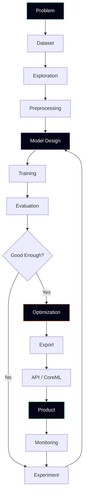
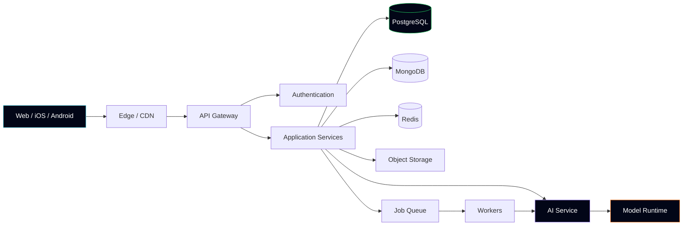
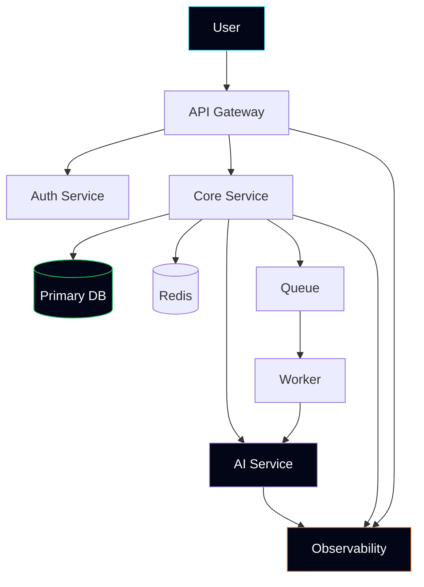
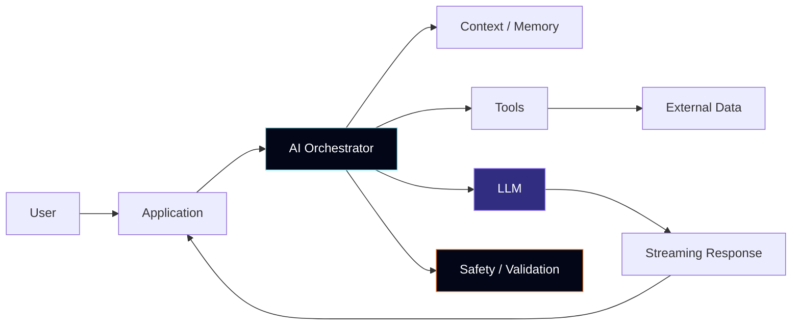
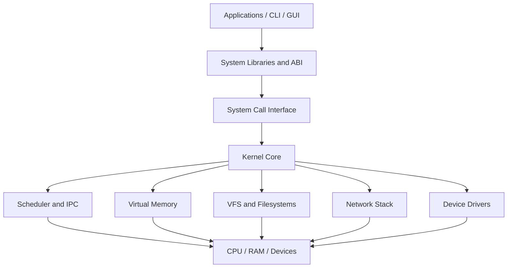
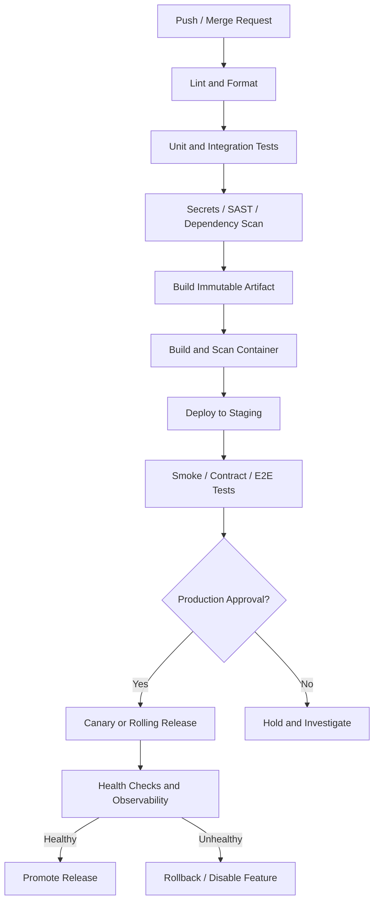

<a name="top"></a>
<div align="center">

<!-- AVINASH PANDEY · CINEMATIC AI ENGINEERING PROFILE · animated edition -->


        

<br/>

<a href="https://github.com/avinash9354" title="Profile views"></a>
<a href="https://github.com/avinash9354" title="Followers"></a>
<a href="https://github.com/avinash9354" title="Stars earned"></a>
<a href="https://github.com/avinash9354" title="Currently building AI"></a>
<a href="https://github.com/avinash9354" title="Innovation mode"></a>

<br/><br/>


<a href="#01--identity" title="Jump to Identity"></a>
<a href="#06--ai-lab" title="Jump to Ai Lab"></a>
<a href="#08--mobile-engineering" title="Jump to Mobile"></a>
<a href="#10--full-stack-architecture" title="Jump to Full Stack"></a>
<a href="#14--project-galaxy" title="Jump to Projects"></a>
<a href="#67--cybersecurity--security-engineering" title="Jump to Security"></a>
<a href="#68--cicd-jenkins--gitlab" title="Jump to Ci/Cd"></a>
<a href="#69--networking--internet-engineering" title="Jump to Networking"></a>
<a href="#71--cloud-platform--infrastructure-engineering" title="Jump to Cloud"></a>
<a href="#advanced-engineering-handbook" title="Jump to Handbook"></a>
<a href="#65--connect" title="Jump to Connect"></a>

<br/><br/>


<br/><br/>

> **"I don't just use technology. I build systems that make technology feel invisible."**

</div>

<details>
<summary><kbd>📚 ENGINEERING INDEX — 46 handbook chapters (click to open)</kbd></summary>

<br/>

| Chapters | |
|---|---|
| [Handbook 01 · Operating System Development — Learning Roadmap](#handbook-01--operating-system-development--learning-roadmap) | [Handbook 02 · Kernel Internals — Memory, Scheduling and I/O](#handbook-02--kernel-internals--memory-scheduling-and-io) |
| [Handbook 03 · OS Security, Boot Integrity and Hardening](#handbook-03--os-security-boot-integrity-and-hardening) | [Handbook 04 · Cybersecurity Foundations and Risk Engineering](#handbook-04--cybersecurity-foundations-and-risk-engineering) |
| [Handbook 05 · Application Security — Web, Mobile and API](#handbook-05--application-security--web-mobile-and-api) | [Handbook 06 · Identity, Cryptography and Secrets Management](#handbook-06--identity-cryptography-and-secrets-management) |
| [Handbook 07 · Network Security and Defensive Operations](#handbook-07--network-security-and-defensive-operations) | [Handbook 08 · SOC, Incident Response and Digital Forensics](#handbook-08--soc-incident-response-and-digital-forensics) |
| [Handbook 09 · Jenkins Pipeline Engineering — Detailed Practice](#handbook-09--jenkins-pipeline-engineering--detailed-practice) | [Handbook 10 · GitLab CI/CD — Detailed Practice](#handbook-10--gitlab-cicd--detailed-practice) |
| [Handbook 11 · Git, Code Review and Release Governance](#handbook-11--git-code-review-and-release-governance) | [Handbook 12 · Networking Fundamentals — Packets, Protocols and Routing](#handbook-12--networking-fundamentals--packets-protocols-and-routing) |
| [Handbook 13 · Advanced Networking — BGP, Load Balancing and Cloud Networks](#handbook-13--advanced-networking--bgp-load-balancing-and-cloud-networks) | [Handbook 14 · System Design — Requirements and Trade-offs](#handbook-14--system-design--requirements-and-trade-offs) |
| [Handbook 15 · System Design — Data, Caching and Distributed Workflows](#handbook-15--system-design--data-caching-and-distributed-workflows) | [Handbook 16 · Distributed Systems and Reliability Engineering](#handbook-16--distributed-systems-and-reliability-engineering) |
| [Handbook 17 · Cloud Engineering and Linux Administration](#handbook-17--cloud-engineering-and-linux-administration) | [Handbook 18 · Kubernetes and Container Platform Engineering](#handbook-18--kubernetes-and-container-platform-engineering) |
| [Handbook 19 · Observability — Logs, Metrics, Traces and Alerts](#handbook-19--observability--logs-metrics-traces-and-alerts) | [Handbook 20 · Performance Engineering and Capacity Planning](#handbook-20--performance-engineering-and-capacity-planning) |
| [Handbook 21 · Testing Strategy and Quality Engineering](#handbook-21--testing-strategy-and-quality-engineering) | [Handbook 22 · Data Engineering, Streaming and Analytics](#handbook-22--data-engineering-streaming-and-analytics) |
| [Handbook 23 · AI/ML Engineering and MLOps](#handbook-23--aiml-engineering-and-mlops) | [Handbook 24 · Compiler Design, Programming Languages and Toolchains](#handbook-24--compiler-design-programming-languages-and-toolchains) |
| [Handbook 25 · Computer Architecture and Hardware Systems](#handbook-25--computer-architecture-and-hardware-systems) | [Handbook 26 · Database Engineering and Transaction Design](#handbook-26--database-engineering-and-transaction-design) |
| [Handbook 27 · API Design and Backend Engineering](#handbook-27--api-design-and-backend-engineering) | [Handbook 28 · Frontend, Mobile and Accessibility Engineering](#handbook-28--frontend-mobile-and-accessibility-engineering) |
| [Handbook 29 · Software Architecture, Patterns and Documentation](#handbook-29--software-architecture-patterns-and-documentation) | [Handbook 30 · Secure Supply Chain and Software Provenance](#handbook-30--secure-supply-chain-and-software-provenance) |
| [Handbook 31 · Privacy Engineering and Compliance Readiness](#handbook-31--privacy-engineering-and-compliance-readiness) | [Handbook 32 · Disaster Recovery and Business Continuity](#handbook-32--disaster-recovery-and-business-continuity) |
| [Handbook 33 · Engineering Management, Estimation and Technical Leadership](#handbook-33--engineering-management-estimation-and-technical-leadership) | [Handbook 34 · Portfolio Project 1 — Educational Operating System](#handbook-34--portfolio-project-1--educational-operating-system) |
| [Handbook 35 · Portfolio Project 2 — Secure API and Threat Model](#handbook-35--portfolio-project-2--secure-api-and-threat-model) | [Handbook 36 · Portfolio Project 3 — Jenkins/GitLab DevSecOps Pipeline](#handbook-36--portfolio-project-3--jenkinsgitlab-devsecops-pipeline) |
| [Handbook 37 · Portfolio Project 4 — Network Observability Lab](#handbook-37--portfolio-project-4--network-observability-lab) | [Handbook 38 · Portfolio Project 5 — Production-Minded Cloud Service](#handbook-38--portfolio-project-5--production-minded-cloud-service) |
| [Handbook 39 · Interview Preparation — Systems and Security Questions](#handbook-39--interview-preparation--systems-and-security-questions) | [Handbook 40 · Glossary — OS and Computer Architecture](#handbook-40--glossary--os-and-computer-architecture) |
| [Handbook 41 · Glossary — Security and Networking](#handbook-41--glossary--security-and-networking) | [Handbook 42 · Glossary — DevOps, Cloud and Reliability](#handbook-42--glossary--devops-cloud-and-reliability) |
| [Handbook 43 · 90-Day Evidence-Based Engineering Roadmap](#handbook-43--90-day-evidence-based-engineering-roadmap) | [Handbook 44 · Responsible Security Research and Disclosure](#handbook-44--responsible-security-research-and-disclosure) |
| [Handbook 45 · Architecture Decision Record Template](#handbook-45--architecture-decision-record-template) | [Handbook 46 · Production Readiness Review Checklist](#handbook-46--production-readiness-review-checklist) |

</details>


<div align="center"></div>

# 00 · `BOOT SEQUENCE`

```text
╔══════════════════════════════════════════════════════════════════════╗
║                          AVINASH.OS :: BOOT                          ║
╠══════════════════════════════════════════════════════════════════════╣
║                                                                      ║
║  [✓] Identity Kernel ...................................... ONLINE   ║
║  [✓] AI Research Engine ................................... ONLINE   ║
║  [✓] iOS Engineering Stack ................................ ONLINE   ║
║  [✓] Flutter Runtime ...................................... ONLINE   ║
║  [✓] Full-Stack Services .................................. ONLINE   ║
║  [✓] Product Architecture ................................. ONLINE   ║
║  [✓] Creative Engine ...................................... ONLINE   ║
║                                                                      ║
║  SYSTEM TARGET:                                                      ║
║                                                                      ║
║  Build → Ship → Measure → Learn → Rebuild → Scale                    ║
║                                                                      ║
║  CURRENT MISSION:                                                    ║
║  Turn ambitious ideas into intelligent, production-grade products.   ║
║                                                                      ║
╚══════════════════════════════════════════════════════════════════════╝
```


<div align="center"></div>

# 01 · `IDENTITY`

<table>
<tr>
<td width="55%" valign="top">

## 👋 Hello, I'm Avinash

I'm an **AI-focused software engineer and product builder** interested in the intersection of:

- 🤖 Artificial Intelligence
- 🧠 Machine Learning
- 📱 iOS Engineering
- 🦋 Flutter Development
- 🌐 Full-Stack Systems
- 🏗️ Software Architecture
- ☁️ Cloud & Deployment
- 🎨 Product Experience
- 🔬 Applied Research

My goal is simple:

> **Take an idea from a blank screen to a real product.**

I enjoy working across the entire stack instead of living inside one layer.

</td>

<td width="45%" align="center">


<br/><br/>


</td>
</tr>
</table>


<div align="center"></div>

# 02 · `WHOAMI`

```yaml
profile:
  name: "Avinash Pandey"
  location: "India 🇮🇳"
  identity:
    - "AI Developer"
    - "iOS Developer"
    - "Flutter Developer"
    - "Full Stack Developer"
    - "ML Explorer"

mission:
  statement: >
    Build intelligent software products that solve meaningful problems
    while delivering exceptional user experiences.

interests:
  artificial_intelligence: true
  machine_learning: true
  mobile_engineering: true
  software_architecture: true
  product_engineering: true
  open_source: true

engineering_style:
  thinking: "systems-first"
  building: "prototype → validate → production"
  priority: "performance + reliability + experience"
  mindset: "learn by building"

current_mode:
  status: "BUILDING"
  energy: "HIGH"
  curiosity: "UNLIMITED"
```


<div align="center"></div>

# 03 · `ENGINEERING DNA`

<div align="center">

| DIMENSION | MY APPROACH |
|---|---|
| 🧠 Thinking | Systems over isolated features |
| 🔬 Learning | Build real projects |
| 🎨 Design | Simple, intentional interfaces |
| ⚡ Performance | Optimize where it matters |
| 🔐 Security | Design security into architecture |
| 🤖 AI | Useful intelligence over hype |
| 📱 Mobile | Native-quality experiences |
| 🌐 Web | Scalable and maintainable systems |
| 🧪 Testing | Validate assumptions early |
| 🚀 Shipping | Working software beats perfect plans |

</div>


<div align="center"></div>

# 04 · `THE TECHNOLOGY CONSTELLATION`

<div align="center">

### Languages


### Frontend


### Backend


### Mobile


### AI / ML


### Databases


### DevOps / Cloud


### Developer Tools


</div>


<div align="center">

### 🎛️ Live Stack Chips <sub>(hover for tooltip · click to open GitHub)</sub>

<a href="https://github.com/avinash9354" title="Swift · part of my stack"></a>
<a href="https://github.com/avinash9354" title="Python · part of my stack"></a>
<a href="https://github.com/avinash9354" title="Dart · part of my stack"></a>
<a href="https://github.com/avinash9354" title="TypeScript · part of my stack"></a>
<a href="https://github.com/avinash9354" title="Flutter · part of my stack"></a>
<a href="https://github.com/avinash9354" title="React · part of my stack"></a>
<a href="https://github.com/avinash9354" title="Next.js · part of my stack"></a>
<a href="https://github.com/avinash9354" title="Node.js · part of my stack"></a>
<a href="https://github.com/avinash9354" title="FastAPI · part of my stack"></a>
<a href="https://github.com/avinash9354" title="PyTorch · part of my stack"></a>
<a href="https://github.com/avinash9354" title="TensorFlow · part of my stack"></a>
<a href="https://github.com/avinash9354" title="OpenCV · part of my stack"></a>
<a href="https://github.com/avinash9354" title="PostgreSQL · part of my stack"></a>
<a href="https://github.com/avinash9354" title="MongoDB · part of my stack"></a>
<a href="https://github.com/avinash9354" title="Redis · part of my stack"></a>
<a href="https://github.com/avinash9354" title="Firebase · part of my stack"></a>
<a href="https://github.com/avinash9354" title="Docker · part of my stack"></a>
<a href="https://github.com/avinash9354" title="Kubernetes · part of my stack"></a>
<a href="https://github.com/avinash9354" title="Terraform · part of my stack"></a>
<a href="https://github.com/avinash9354" title="Jenkins · part of my stack"></a>
<a href="https://github.com/avinash9354" title="GitLab · part of my stack"></a>
<a href="https://github.com/avinash9354" title="GitHub Actions · part of my stack"></a>
<a href="https://github.com/avinash9354" title="Linux · part of my stack"></a>
<a href="https://github.com/avinash9354" title="Xcode · part of my stack"></a>

</div>

<div align="center"></div>

# 05 · `LANGUAGE MATRIX`

```text
┌─────────────────────────────────────────────────────────────────┐
│                    LANGUAGE ENGINEERING MAP                     │
├──────────────────────┬──────────────────────┬───────────────────┤
│ Swift                │ ██████████████████░░ │ Mobile            │
│ Python               │ ███████████████████░ │ AI / ML           │
│ TypeScript           │ █████████████████░░░ │ Full Stack        │
│ Dart                 │ ████████████████░░░░ │ Flutter           │
│ JavaScript           │ ████████████████░░░░ │ Web               │
│ Java                 │ █████████████░░░░░░░ │ Backend            │
│ C++                  │ ███████████░░░░░░░░░ │ Systems / DSA      │
│ C                    │ ██████████░░░░░░░░░░ │ Fundamentals       │
└──────────────────────┴──────────────────────┴───────────────────┘
```


<div align="center"></div>

# 06 · `AI LAB`

<div align="center">


</div>

## 🧠 Areas of Exploration

```text
                    ┌────────────────────┐
                    │    AI APPLICATION   │
                    └─────────┬──────────┘
                              │
          ┌───────────────────┼───────────────────┐
          ▼                   ▼                   ▼
   ┌─────────────┐     ┌─────────────┐     ┌─────────────┐
   │  GENERATIVE │     │ COMPUTER    │     │  PREDICTIVE │
   │     AI      │     │   VISION    │     │     ML      │
   └──────┬──────┘     └──────┬──────┘     └──────┬──────┘
          │                   │                   │
          ▼                   ▼                   ▼
       LLMs               CNNs              Regression
       Agents             Detection         Classification
       RAG                Restoration       Forecasting
       Prompting          Segmentation      Optimization
```

### Current AI Interests

- Neural network architectures
- Computer vision
- Image enhancement
- Generative AI
- LLM-powered applications
- On-device inference
- CoreML optimization
- Model compression
- AI product engineering
- Real-time inference pipelines


<div align="center"></div>

# 07 · `AI ENGINEERING PIPELINE`




<div align="center"></div>

# 08 · `MOBILE ENGINEERING`

## 🍎 iOS

My iOS engineering interests include:

- Swift
- SwiftUI
- UIKit
- CoreML
- Core Data
- Networking
- Concurrency
- MVVM
- Modular architecture
- App performance
- Accessibility
- Animation
- API integration

### iOS Philosophy

```text
UI
 ↓
Presentation
 ↓
Domain
 ↓
Data
 ↓
Infrastructure
 ↓
External Services
```

The objective:

> **Keep features independent, testable and scalable.**


<div align="center"></div>

# 09 · `FLUTTER ENGINEERING`

```text
Flutter Application
        │
        ├── Presentation
        │      ├── Widgets
        │      ├── Animations
        │      └── Themes
        │
        ├── State
        │      ├── Riverpod
        │      └── Reactive State
        │
        ├── Domain
        │      ├── Use Cases
        │      └── Entities
        │
        ├── Data
        │      ├── APIs
        │      ├── Firebase
        │      └── Local Storage
        │
        └── AI
               ├── On-device models
               ├── Image processing
               └── Intelligent features
```


<div align="center"></div>

# 10 · `FULL STACK ARCHITECTURE`




<div align="center"></div>

# 11 · `BACKEND MINDSET`

### API Design

```text
REQUEST
   ↓
Validation
   ↓
Authentication
   ↓
Authorization
   ↓
Business Logic
   ↓
Persistence
   ↓
Response
   ↓
Observability
```

### Backend Priorities

- predictable APIs
- strong validation
- clean error handling
- authentication
- authorization
- caching
- database indexing
- observability
- rate limiting
- graceful failures


<div align="center"></div>

# 12 · `DATABASE LAB`

<div align="center">

| DATABASE | USE CASE |
|---|---|
| PostgreSQL | Relational systems |
| MongoDB | Document-oriented systems |
| Firebase | Rapid product development |
| Redis | Cache / queues / fast state |
| MySQL | Relational workloads |

</div>

### Data Engineering Principle

```text
Fast queries are designed,
not hoped for.

Schema
  ↓
Indexes
  ↓
Query plan
  ↓
Cache
  ↓
Observability
```


<div align="center"></div>

# 13 · `DEVOPS ENGINE`

```text
Developer
    │
    ▼
Git Commit
    │
    ▼
Pull Request
    │
    ▼
Automated Checks
    │
    ├── Lint
    ├── Test
    ├── Build
    └── Security
    │
    ▼
Container
    │
    ▼
Deployment
    │
    ▼
Monitoring
```

### Tools

- Git
- GitHub
- GitHub Actions
- Docker
- Linux
- Vercel
- Render
- Cloud infrastructure
- CI/CD pipelines


<div align="center"></div>

# 14 · `PROJECT GALAXY`

## ✈️ Flight Booking iOS

**Category:** FinTech / Travel / Mobile

```text
SEARCH
  ↓
FLIGHTS
  ↓
FILTER
  ↓
DETAILS
  ↓
PASSENGERS
  ↓
PAYMENT
  ↓
CONFIRMATION
  ↓
TICKET
```

### Engineering Focus

- SwiftUI interface
- booking state management
- API integration
- payment architecture
- passenger data
- ticket generation
- error states
- loading states
- responsive UX

---

## 🤖 AI Conversational Application

**Category:** Generative AI

```text
USER
 ↓
PROMPT
 ↓
CONTEXT
 ↓
AI SERVICE
 ↓
MODEL
 ↓
STREAM
 ↓
UI
```

### Product Goals

- fast response rendering
- conversational UX
- streaming responses
- conversation history
- intelligent context
- clean mobile interface

---

## 🎨 AI Photo Editor

**Category:** Computer Vision

```text
PHOTO
 ↓
PREPROCESS
 ↓
MODEL
 ↓
INFERENCE
 ↓
POSTPROCESS
 ↓
RESULT
```

Potential capabilities:

- denoise
- enhancement
- restoration
- upscaling
- color improvement
- intelligent cropping
- on-device processing

---

## 🛰️ Satellite Image Reconstruction

**Category:** Generative AI / Earth Observation

```text
Satellite Image
       ↓
Cloud Detection
       ↓
Cloud Mask
       ↓
Context Extraction
       ↓
Reconstruction Model
       ↓
Enhancement
       ↓
Quality Evaluation
       ↓
Restored Image
```


<div align="center"></div>

# 15 · `PRODUCT ENGINEERING`

I don't think only in terms of features.

I think in terms of:

```text
Problem
 ↓
User
 ↓
Experience
 ↓
System
 ↓
Data
 ↓
AI
 ↓
Infrastructure
 ↓
Business
 ↓
Scale
```

A good product isn't only technically impressive.

It should also be:

- understandable
- reliable
- fast
- useful
- maintainable
- measurable


<div align="center"></div>

# 16 · `UI / UX ENGINE`

### Design Principles

```text
LESS NOISE
    ↓
CLEAR HIERARCHY
    ↓
FAST FEEDBACK
    ↓
INTENTIONAL MOTION
    ↓
ACCESSIBLE INTERACTION
```

### Animation Philosophy

Animation should communicate:

- state
- hierarchy
- transition
- feedback
- personality

Not simply exist because it can.


<div align="center"></div>

# 17 · `SYSTEM DESIGN`




<div align="center"></div>

# 18 · `SECURITY FIRST`

Security belongs inside the architecture.

### Security Checklist

```text
[✓] Authentication
[✓] Authorization
[✓] Input validation
[✓] Secret management
[✓] Encryption
[✓] Rate limiting
[✓] Secure storage
[✓] Dependency updates
[✓] Logging
[✓] Monitoring
[✓] Least privilege
```


<div align="center"></div>

# 19 · `PERFORMANCE LAB`

### Optimization Layers

```text
UI
 ↓
Network
 ↓
API
 ↓
Database
 ↓
Cache
 ↓
Compute
 ↓
Model
```

### Performance Questions

- What is the latency budget?
- What can be cached?
- What can be parallelized?
- What should be asynchronous?
- What belongs on-device?
- What belongs server-side?
- Where is the bottleneck?


<div align="center"></div>

# 20 · `AI + MOBILE`

One of my strongest interests is bringing AI closer to the user.

```text
                 AI PRODUCT
                     │
          ┌──────────┴──────────┐
          ▼                     ▼
      CLOUD AI             ON-DEVICE AI
          │                     │
      Powerful              Private
      Flexible              Fast
      Scalable              Offline
          │                     │
          └──────────┬──────────┘
                     ▼
                HYBRID SYSTEM
```


<div align="center"></div>

# 21 · `COREML LAB`

### Model Deployment Pipeline

```text
PyTorch / TensorFlow
        ↓
Model Validation
        ↓
Optimization
        ↓
Conversion
        ↓
CoreML
        ↓
iOS Integration
        ↓
Benchmark
        ↓
Production
```

Goals:

- lower latency
- lower memory usage
- better battery efficiency
- privacy
- offline inference


<div align="center"></div>

# 22 · `COMPUTER VISION`

Areas of interest:

| AREA | APPLICATION |
|---|---|
| Classification | Image understanding |
| Detection | Object localization |
| Segmentation | Pixel-level understanding |
| Restoration | Damaged image recovery |
| Enhancement | Visual quality |
| OCR | Text extraction |
| Tracking | Object movement |
| Transformation | Perspective / geometry |


<div align="center"></div>

# 23 · `MACHINE LEARNING WORKBENCH`

```text
Dataset
   │
   ├── Clean
   ├── Normalize
   ├── Augment
   └── Split
        │
        ▼
     Training
        │
        ├── Baseline
        ├── Experiment
        ├── Tune
        └── Validate
        │
        ▼
     Evaluation
        │
        ├── Accuracy
        ├── Precision
        ├── Recall
        ├── F1
        └── Latency
        │
        ▼
     Deployment
```


<div align="center"></div>

# 24 · `GENERATIVE AI`

### Application Architecture




<div align="center"></div>

# 25 · `OPEN SOURCE MINDSET`

Open source isn't just publishing code.

It is:

```text
Readable Code
     +
Useful Documentation
     +
Reproducible Setup
     +
Issues
     +
Discussions
     +
Community
     =
Healthy Project
```


<div align="center"></div>

# 26 · `GIT WORKFLOW`

```text
main
 │
 ├── feature/*
 │
 ├── fix/*
 │
 ├── refactor/*
 │
 └── experiment/*
        │
        ▼
      PR
        │
        ▼
   Review / CI
        │
        ▼
     Merge
        │
        ▼
      Release
```


<div align="center"></div>

# 27 · `CODE QUALITY`

### I care about

- readability
- naming
- separation of concerns
- error handling
- testability
- documentation
- predictable behavior
- performance
- maintainability

### Rule

> If future-me cannot understand it, present-me needs to refactor it.


<div align="center"></div>

# 28 · `RESEARCH MODE`

Research questions I like:

```text
Can AI run efficiently on-device?

How can models become smaller without losing quality?

How can computer vision solve real-world problems?

How can mobile apps use AI without feeling slow?

How should AI systems handle context?

How can intelligent systems become simpler for users?
```


<div align="center"></div>

# 29 · `LEARNING ENGINE`

```text
           CURIOUS
              │
              ▼
           QUESTION
              │
              ▼
           RESEARCH
              │
              ▼
           PROTOTYPE
              │
              ▼
           FAILURE
              │
              ▼
           LEARNING
              │
              ▼
           IMPROVEMENT
              │
              ▼
           PRODUCT
              │
              └──────────────► CURIOUS
```


<div align="center"></div>

# 30 · `CURRENTLY LEVELING UP`

<div align="center">


</div>


<div align="center"></div>

# 31 · `SKILL RADAR`

> I prefer evidence over invented percentages. The topics below are engineering areas I work on, study, or build projects around; depth varies by technology.

```text
AI / ML · Mobile Engineering · Full Stack · Backend
System Design · OS Development · Cybersecurity · Networking
CI/CD · Cloud Infrastructure · Distributed Systems · Data Engineering

Progress is demonstrated through:
  → public repositories and working demos
  → tests, benchmarks and reproducible builds
  → architecture decision records
  → deployment, monitoring and incident learnings
```


<div align="center"></div>

# 32 · `TOOLBOX`

<div align="center">


</div>


<div align="center"></div>

# 33 · `ARCHITECTURE PRINCIPLES`

```text
01  Keep boundaries clear.
02  Make dependencies explicit.
03  Prefer boring infrastructure when possible.
04  Measure before optimizing.
05  Design failure states.
06  Treat security as a feature.
07  Keep AI observable.
08  Make systems replaceable.
09  Automate repetitive work.
10  Build for the next engineer too.
```


<div align="center"></div>

# 34 · `PRODUCT DEVELOPMENT LOOP`


<div align="center"></div>

# 35 · `PROJECT BLUEPRINT`

Every serious project starts with:

```text
┌──────────────────────────────────────────┐
│               PROJECT                    │
├──────────────────────────────────────────┤
│ Problem                                  │
│ User                                     │
│ Value Proposition                        │
│ Architecture                             │
│ Technology                               │
│ Data                                     │
│ Security                                 │
│ AI / Automation                          │
│ UX                                       │
│ Testing                                  │
│ Deployment                               │
│ Monitoring                               │
│ Scale                                    │
└──────────────────────────────────────────┘
```


<div align="center"></div>

# 36 · `FLAGSHIP PROJECT CARDS`

## 🚀 Orbix Ecosystem

An ambitious technology ecosystem exploring:

- intelligent software
- browser experiences
- secure operating environments
- AI-assisted workflows
- developer tooling
- scalable infrastructure

---

## 🌌 SkyAI

A concept around AI-powered travel and intelligent trip experiences.

Potential layers:

```text
Travel Search
     ↓
Recommendation Engine
     ↓
AI Assistant
     ↓
Itinerary
     ↓
Booking
     ↓
Payments
     ↓
Post-Trip Intelligence
```

---

## 💬 AI Assistant Platforms

Focus:

- conversational UI
- context
- tool calling
- memory
- personalization
- multimodal interaction
- streaming
- intelligent workflows

---

## 🛰️ Satellite AI

Research direction:

```text
Remote Sensing
     +
Computer Vision
     +
Generative Models
     =
Intelligent Earth Observation
```


<div align="center"></div>

# 37 · `APP ARCHITECTURE PATTERN`

```text
┌──────────────────────────────┐
│            UI                │
├──────────────────────────────┤
│         View Model           │
├──────────────────────────────┤
│          Domain              │
├──────────────────────────────┤
│           Data               │
├──────────────────────────────┤
│       Infrastructure         │
└──────────────────────────────┘
```

Benefits:

- easier testing
- cleaner features
- replaceable APIs
- maintainable code
- scalable teams


<div align="center"></div>

# 38 · `API ENGINEERING`

### Request lifecycle

```text
HTTP Request
    ↓
Router
    ↓
Middleware
    ↓
Validation
    ↓
Controller
    ↓
Service
    ↓
Repository
    ↓
Database
    ↓
Serializer
    ↓
HTTP Response
```


<div align="center"></div>

# 39 · `OBSERVABILITY`

A production system should answer:

```text
What happened?
When did it happen?
Where did it happen?
Why did it happen?
How many users were affected?
How long did it take?
Did it recover?
```

Observability:

- logs
- metrics
- traces
- alerts
- dashboards


<div align="center"></div>

# 40 · `SCALABILITY`

```text
1 USER
   ↓
10 USERS
   ↓
1K USERS
   ↓
100K USERS
   ↓
1M USERS
```

The architecture must evolve.

### Scale levers

- caching
- queues
- horizontal scaling
- database indexes
- read replicas
- asynchronous processing
- CDN
- model optimization
- load balancing


<div align="center"></div>

# 41 · `AI SCALABILITY`

```text
MODEL
 ↓
OPTIMIZATION
 ↓
BATCHING
 ↓
CACHING
 ↓
QUEUE
 ↓
WORKERS
 ↓
GPU POOL
 ↓
AUTOSCALING
```


<div align="center"></div>

# 42 · `MOBILE PERFORMANCE`

### Performance targets

```text
Fast launch
     ↓
Smooth navigation
     ↓
Efficient rendering
     ↓
Minimal network waits
     ↓
Smart caching
     ↓
Efficient AI inference
     ↓
Battery awareness
```


<div align="center"></div>

# 43 · `DESIGN SYSTEM`

### UI tokens

```text
COLOR
├── Background
├── Surface
├── Primary
├── Accent
└── Danger

TYPE
├── Display
├── Heading
├── Body
└── Caption

MOTION
├── Enter
├── Exit
├── Transition
└── Feedback

SPACING
├── XS
├── SM
├── MD
├── LG
└── XL
```


<div align="center"></div>

# 44 · `ANIMATION LAB`

Animations I like:

- spring transitions
- staggered entrance
- shared-element motion
- scroll-based motion
- particle effects
- subtle parallax
- loading skeletons
- state transitions
- micro-interactions

Rule:

> **Motion should explain what changed.**


<div align="center"></div>

# 45 · `GITHUB TELEMETRY`

<div align="center">


<br/><br/>


</div>


<div align="center"></div>

# 46 · `CONTRIBUTION ENGINE`

<div align="center">


</div>


<div align="center"></div>

# 47 · `LANGUAGE TELEMETRY`

<div align="center">


</div>


<div align="center"></div>

# 48 · `CODING PHILOSOPHY`

```text
┌──────────────────────────────────────────────────────────────┐
│                                                              │
│  CODE SHOULD BE                                               │
│                                                              │
│       SIMPLE                                                  │
│         ↓                                                    │
│       READABLE                                                │
│         ↓                                                    │
│       TESTABLE                                                │
│         ↓                                                    │
│       OBSERVABLE                                              │
│         ↓                                                    │
│       SCALABLE                                                │
│                                                              │
└──────────────────────────────────────────────────────────────┘
```


<div align="center"></div>

# 49 · `FAILURE PHILOSOPHY`

Failure isn't the opposite of progress.

```text
TRY
 ↓
FAIL
 ↓
OBSERVE
 ↓
UNDERSTAND
 ↓
CHANGE
 ↓
TRY AGAIN
```

Every failed prototype is information.


<div align="center"></div>

# 50 · `LEARNING STACK`

```text
FOUNDATION
├── Mathematics
├── Algorithms
├── Data Structures
└── Computer Science

ENGINEERING
├── Architecture
├── APIs
├── Databases
├── Networking
└── Security

INTELLIGENCE
├── Machine Learning
├── Deep Learning
├── Computer Vision
├── Generative AI
└── Model Deployment

PRODUCT
├── UX
├── Design
├── Analytics
├── Growth
└── Business
```


<div align="center"></div>

# 51 · `ROADMAP`

## Phase I — Foundation

- strengthen CS fundamentals
- algorithms
- system design
- software architecture
- advanced programming

## Phase II — AI

- deep learning
- computer vision
- generative AI
- model deployment
- on-device inference

## Phase III — Product

- intelligent mobile apps
- AI assistants
- computer vision products
- scalable backend systems

## Phase IV — Infrastructure

- distributed systems
- cloud architecture
- GPU infrastructure
- observability
- high-scale systems

## Phase V — Innovation

- original research
- open-source projects
- new product ideas
- large-scale AI systems


<div align="center"></div>

# 52 · `2026 → FUTURE`

```text
2026
 │
 ├── AI Applications
 ├── Advanced iOS
 ├── Flutter
 ├── ML Systems
 └── Product Engineering
       │
       ▼
2027
 │
 ├── Advanced AI
 ├── System Design
 ├── Cloud
 ├── Research
 └── Large-scale products
       │
       ▼
2030+
 │
 └── Build technology that changes industries.
```


<div align="center"></div>

# 53 · `WHAT I'M BUILDING TOWARD`

### 🎯 Long-Term Vision

```text
AI
 +
SOFTWARE ENGINEERING
 +
PRODUCT DESIGN
 +
SYSTEM ARCHITECTURE
 +
RESEARCH
 =
TECHNOLOGY PRODUCTS
```

The destination isn't a specific programming language.

The destination is:

> **Being able to take a difficult problem and build the entire solution.**


<div align="center"></div>

# 54 · `ENGINEERING CHECKLIST`

Before shipping:

```text
[ ] Does the feature solve the actual problem?
[ ] Is the UX understandable?
[ ] Are loading states handled?
[ ] Are errors handled?
[ ] Is the data secure?
[ ] Is the API reliable?
[ ] Is the database indexed?
[ ] Is performance acceptable?
[ ] Is the system observable?
[ ] Can another engineer maintain it?
[ ] Can it scale?
[ ] Can it be tested?
```


<div align="center"></div>

# 55 · `AI PRODUCT CHECKLIST`

```text
[ ] Model quality
[ ] Latency
[ ] Cost
[ ] Privacy
[ ] Hallucination handling
[ ] Context management
[ ] Prompt robustness
[ ] Evaluation
[ ] Monitoring
[ ] Fallback behavior
[ ] User feedback
[ ] Continuous improvement
```


<div align="center"></div>

# 56 · `WHY I BUILD`

I like the moment when:

```text
       IDEA
        │
        ▼
     NOTHING
        │
        ▼
      CODE
        │
        ▼
    PROTOTYPE
        │
        ▼
     PRODUCT
        │
        ▼
      USERS
        │
        ▼
      IMPACT
```

That transformation is what keeps me building.


<div align="center"></div>

# 57 · `BEYOND CODE`

Technology is not only about writing code.

It is also about:

- asking better questions
- understanding users
- designing systems
- communicating ideas
- making trade-offs
- learning from failure
- thinking long-term


<div align="center"></div>

# 58 · `COLLABORATION`

I enjoy collaborating around:

```text
AI
├── Applied ML
├── Generative AI
└── Computer Vision

Mobile
├── iOS
└── Flutter

Engineering
├── Backend
├── Cloud
└── Architecture

Products
├── Startups
├── Experiments
└── Open Source
```


<div align="center"></div>

# 59 · `OPEN SOURCE MISSION`

```text
BUILD
 ↓
DOCUMENT
 ↓
SHARE
 ↓
GET FEEDBACK
 ↓
IMPROVE
 ↓
HELP OTHERS
 ↓
BUILD AGAIN
```


<div align="center"></div>

# 60 · `PROFILE COMMAND CENTER`

<div align="center">

| COMMAND | PURPOSE |
|---|---|
| 🧠 AI | Artificial Intelligence |
| 📱 MOBILE | iOS + Flutter |
| 🌐 WEB | Full Stack |
| ⚙️ SYSTEMS | Architecture |
| 🔬 LAB | Research |
| 🚀 PRODUCTS | Product Engineering |
| ☁️ CLOUD | Infrastructure |
| 🛠️ TOOLS | Developer Workflow |

</div>


<div align="center"></div>

# 61 · `CURRENT PROJECT RADAR`

```text
                         ┌───────────────┐
                         │   AI APPS     │
                         └───────┬───────┘
                                 │
             ┌───────────────────┼──────────────────┐
             ▼                   ▼                  ▼
       ┌───────────┐       ┌───────────┐      ┌───────────┐
       │   iOS     │       │   FLUTTER │      │   WEB     │
       └─────┬─────┘       └─────┬─────┘      └─────┬─────┘
             │                   │                  │
             └───────────────────┼──────────────────┘
                                 ▼
                         ┌───────────────┐
                         │   AI CORE     │
                         └───────────────┘
```


<div align="center"></div>

# 62 · `ENGINEERING VALUES`

### Curiosity

Never stop asking why.

### Ownership

If I build it, I understand it.

### Simplicity

Complex systems should feel simple to users.

### Reliability

A feature isn't finished until failure is considered.

### Growth

Every project should teach something.

### Impact

Technology matters when people can use it.


<div align="center"></div>

# 63 · `TERMINAL`

```bash
$ whoami
avinash-pandey

$ focus
AI + Software Engineering

$ stack
Swift Python Dart TypeScript Java React Node Flutter PyTorch

$ mission
Build intelligent products.

$ status
██████████████████████████████████████ ONLINE

$ next
Create something impossible.
```


<div align="center"></div>

# 64 · `SIGNAL`

<div align="center">


</div>


<div align="center"></div>

# 65 · `CONNECT`

<div align="center">


<br/><br/>

<a href="https://github.com/avinash9354" title="Open my GitHub"></a>
<a href="https://www.linkedin.com/in/avinashpandeyai/" title="Connect on LinkedIn"></a>
<a href="https://www.instagram.com/mr.avi_pandey/" title="Follow on Instagram"></a>
<a href="mailto:avinash9354@email.com" title="Send an email"></a>

<br/><br/>


</div>

---


<div align="center"></div>

# 66 · `OPERATING SYSTEM ENGINEERING`

<div align="center">


</div>

Operating-system engineering spans hardware interfaces, privileged execution, memory, scheduling, storage, security boundaries, and user-space services. This section maps the technologies and concepts I study and use when building systems-oriented projects.

### OS development stack

| Layer | Concepts and technologies |
|---|---|
| Boot process | BIOS/UEFI, bootloaders, GRUB, UEFI applications, boot protocols |
| Kernel foundations | C, C++, Rust, assembly (x86-64, ARM64), linker scripts, cross-compilers |
| CPU and interrupts | privilege rings, exceptions, interrupt descriptor tables, APIC, context switching |
| Memory management | virtual memory, paging, page tables, allocators, heaps, memory-mapped I/O |
| Processes and threads | scheduling, context switches, synchronization, IPC, signals, system calls |
| Drivers | PCI/PCIe, USB, storage, input, display, network interfaces, device trees |
| Storage and filesystems | block devices, VFS, FAT, ext-family concepts, journaling, permissions |
| Networking | Ethernet, sockets, TCP/IP, routing, packet buffers, network drivers |
| User space | C runtime, shell, utilities, daemons, init systems, service management |
| Build and debug | Make, CMake, Ninja, LLVM/Clang, GCC, GDB, LLDB, QEMU, Bochs |
| Testing | unit tests, integration tests, kernel tests, emulation, fuzzing, crash dumps |
| Virtualization | QEMU/KVM, Hyper-V concepts, VirtualBox, containers, hardware-assisted virtualization |

### OS architecture map



### Advanced OS topics

- Kernel/user-mode isolation, syscall ABI design, capabilities, permissions and privilege separation
- SMP and multicore scheduling, locks, atomics, race conditions, deadlocks and memory ordering
- Page faults, copy-on-write, memory-mapped files, shared memory and allocator design
- Interrupt handling, DMA, IOMMU concepts, device discovery and driver lifecycle
- Secure boot, measured boot, kernel hardening, signed modules and trusted update paths
- Containers, namespaces, cgroups, seccomp, virtual machines and hypervisor boundaries
- Crash analysis, core dumps, tracing, profiling, reproducible builds and supply-chain integrity

> **Project direction:** Build a small educational kernel in an emulator, document the boot-to-shell path, add memory management and a basic scheduler incrementally, and publish tests and architecture notes. A project is evidence of skill; a technology list alone is not.


<div align="center"></div>

# 67 · `CYBERSECURITY & SECURITY ENGINEERING`

<div align="center">


</div>

Security is a lifecycle: threat-model, prevent, detect, respond, recover, and learn. The focus is authorized testing, defensive engineering, and responsible disclosure.

### Security domains and tooling

| Domain | Concepts / tools to learn and apply |
|---|---|
| Security foundations | CIA triad, threat modeling, attack surface, risk, least privilege, zero trust |
| Application security | OWASP Top 10, ASVS, secure coding, output encoding, input validation |
| API security | OAuth 2.0, OpenID Connect, JWT validation, scopes, object-level authorization, rate limits |
| Identity and access | MFA, passkeys, RBAC, ABAC, IAM, PAM, session security, secrets rotation |
| Network defense | firewalls, segmentation, VPN, IDS/IPS, DNS security, TLS, packet analysis |
| Web testing | OWASP ZAP, Burp Suite Community, browser devtools, safe test environments |
| Vulnerability management | CVE, CVSS, patch prioritization, dependency inventory, remediation verification |
| Static and dynamic analysis | Semgrep, CodeQL, SAST, DAST, IAST concepts, fuzzing, secure code review |
| Dependency / supply chain | SBOM, SCA, signed artifacts, provenance, lockfiles, pinned actions and images |
| Endpoint / host defense | hardening, EDR concepts, audit logs, file integrity, patching, secure baselines |
| Cloud security | IAM policies, private networking, KMS, secret managers, workload identity, posture management |
| Containers and Kubernetes | image scanning, admission policies, RBAC, network policies, runtime restrictions |
| Detection and response | SIEM concepts, alert triage, incident timelines, containment, eradication, recovery |
| Digital forensics | evidence handling, chain of custody, disk and memory artifacts, log correlation |
| Cryptography | hashing, MACs, digital signatures, key exchange, PKI, certificates, key lifecycle |
| Governance | NIST CSF, NIST SSDF, ISO 27001 concepts, CIS Benchmarks, privacy and audit evidence |

### Secure development lifecycle


### Security checklist

- [ ] Threat model important assets, trust boundaries, abuse cases and likely failure modes.
- [ ] Enforce authorization on the server for every sensitive operation and object.
- [ ] Store secrets in a secret manager; never commit credentials, private keys or production tokens.
- [ ] Validate input and encode output; use parameterized queries and safe deserialization.
- [ ] Use modern TLS, secure cookie flags, CSRF defenses where applicable, and secure session rotation.
- [ ] Add dependency, secret, container and infrastructure-as-code scanning to CI.
- [ ] Apply least privilege, MFA, short-lived credentials, logging and tested recovery procedures.
- [ ] Document scope and obtain written permission before security testing.

**Ethical boundary:** security labs, owned systems, CTFs, and explicitly authorized assessments only. Avoid presenting unverified tool familiarity as professional penetration-testing experience.


<div align="center"></div>

# 68 · `CI/CD, JENKINS & GITLAB`

<div align="center">


</div>

### CI/CD platform map

| Platform / tool | Engineering use |
|---|---|
| Jenkins | Pipeline as Code, Jenkinsfile, agents, credentials, shared libraries, artifacts |
| GitLab CI/CD | `.gitlab-ci.yml`, stages, runners, environments, artifacts, protected variables |
| GitHub Actions | workflows, reusable workflows, runners, environments, release automation |
| Git | branching, commits, tags, code review, release history |
| Docker / BuildKit | repeatable builds, multi-stage images, image metadata, layer caching |
| Kubernetes | deployment rollout, probes, resource limits, autoscaling, rollback |
| Terraform / OpenTofu | infrastructure as code, plans, state, modules, policy checks |
| Ansible | configuration management, idempotent automation, controlled rollout |
| Argo CD / Flux | GitOps reconciliation and declarative deployment |
| Helm / Kustomize | Kubernetes packaging and environment overlays |
| SonarQube / Semgrep | code quality and static analysis |
| Trivy / Grype | container and dependency vulnerability scanning |
| Prometheus / Grafana | metrics, dashboards, alerting and release health |

### Example production pipeline



### Jenkins — core concepts

- Declarative and scripted pipelines; `Jenkinsfile`; stages, steps, post actions
- Agents, labels, executors, ephemeral build workers and isolated build environments
- Credentials binding, folder permissions, RBAC, secret masking and least privilege
- Shared libraries, artifact retention, test reports and pipeline reuse
- Webhook triggers, branch conditions, approvals, deployment gates and rollback paths
- Plugin governance, controller/agent separation, backup, upgrades and audit logs

### GitLab CI/CD — core concepts

- Stages and jobs, `needs`, `rules`, `workflow`, includes and reusable templates
- Shared, group and project runners; protected branches, tags and environments
- Cache versus artifacts, artifact expiry, job dependencies and test reports
- Merge-request pipelines, code owners, approval rules and protected variables
- Container registry, environment promotion, deployment approvals and rollback
- OIDC/federated cloud credentials where supported, avoiding long-lived cloud keys

### Release engineering principles

1. Build once and promote the same immutable artifact between environments.
2. Keep development, staging and production configuration separate.
3. Use short-lived credentials, protected deployment environments and auditable approvals.
4. Test database migrations and define backward-compatible rollout/rollback plans.
5. Use canary, blue-green or rolling deployments according to system risk.
6. Track DORA-style delivery metrics: deployment frequency, lead time, change failure rate and recovery time.
7. Keep a documented rollback path and verify it through drills.


<div align="center"></div>

# 69 · `NETWORKING & INTERNET ENGINEERING`

<div align="center">


</div>

### Networking knowledge map

| Layer / area | Topics and technologies |
|---|---|
| Fundamentals | OSI and TCP/IP models, encapsulation, MTU, latency, jitter, packet loss |
| Link layer | Ethernet, MAC, ARP, VLANs, STP, Wi-Fi, switching |
| IP layer | IPv4, IPv6, CIDR, subnetting, ICMP, NAT, routing tables |
| Routing | static routing, OSPF, BGP concepts, route selection, ECMP |
| Transport | TCP handshake, congestion control, UDP, QUIC, ports, sockets |
| Application | HTTP/1.1, HTTP/2, HTTP/3, DNS, DHCP, SMTP, SSH, NTP |
| Security | TLS, PKI, firewalls, VPNs, IPsec, WireGuard, segmentation, ACLs |
| Load distribution | reverse proxies, L4/L7 load balancers, health checks, CDN, anycast |
| Troubleshooting | `ping`, `traceroute`, `dig`, `nslookup`, `curl`, `ss`, `tcpdump`, Wireshark |
| Enterprise / provider | subnet planning, high availability, redundant links, BGP policy, QoS concepts |
| Cloud networking | VPC/VNet, subnets, route tables, NAT gateways, private endpoints, peering |
| Service networking | service discovery, ingress, egress controls, service mesh and mTLS concepts |

### Request path

```text
Browser / Mobile App
  → DNS Resolution
  → TCP or QUIC Connection
  → TLS Handshake
  → CDN / Edge
  → WAF / Load Balancer
  → API Gateway / Reverse Proxy
  → Application Service
  → Database / Cache / Queue
  → Response
```

### Practical networking labs

- Design IPv4/IPv6 subnets and document address allocation and routing.
- Capture traffic in Wireshark and explain DNS lookup, TCP setup and TLS negotiation.
- Configure a private lab with VLANs, firewall rules and a VPN.
- Deploy a reverse proxy with TLS, health checks and rate limiting.
- Diagnose DNS, MTU, packet loss, asymmetric routing and certificate failures.
- Document network diagrams, ports, trust zones, ingress/egress and recovery paths.


<div align="center"></div>

# 70 · `COMPUTER SCIENCE CORE`

The strongest engineering profiles connect implementation to the underlying concepts. This is the broader CS map behind the tools.

| Field | Core topics |
|---|---|
| Mathematics | discrete math, logic, sets, combinatorics, probability, statistics, linear algebra, calculus |
| Algorithms | sorting, searching, recursion, greedy methods, dynamic programming, graph algorithms |
| Data structures | arrays, linked lists, stacks, queues, trees, heaps, hash tables, tries, graphs |
| Complexity | Big-O, time/space trade-offs, amortized analysis, lower bounds |
| Programming languages | paradigms, type systems, generics, memory models, interpreters, language tooling |
| Compilers | lexing, parsing, ASTs, semantic analysis, IR, optimization, code generation |
| Operating systems | processes, threads, scheduling, virtual memory, filesystems, synchronization |
| Computer architecture | ISA, registers, caches, pipelines, branch prediction, SIMD, interrupts |
| Databases | relational algebra, normalization, transactions, ACID, isolation, indexing, query plans |
| Distributed systems | replication, partitioning, consensus concepts, idempotency, consistency, fault tolerance |
| Networking | protocols, routing, congestion control, sockets, distributed communication |
| Software engineering | requirements, modularity, design patterns, testing, code review, refactoring |
| Formal methods | invariants, state machines, contracts, model checking concepts, property-based testing |
| Human-computer interaction | usability, accessibility, interaction design, cognitive load |
| Information security | cryptography, secure design, identity, threat modeling, risk management |
| Data engineering | ETL/ELT, batch/stream processing, data quality, lineage, governance |
| AI / ML | optimization, generalization, evaluation, neural networks, model deployment and monitoring |

### Algorithms and problem-solving workflow

```text
Understand Constraints
  → Define Correctness
  → Choose Data Structure
  → Analyze Time and Space
  → Implement
  → Test Edge Cases
  → Benchmark
  → Explain Trade-offs
```


<div align="center"></div>

# 71 · `CLOUD, PLATFORM & INFRASTRUCTURE ENGINEERING`

<div align="center">


</div>

### Infrastructure domains

- **Cloud:** compute, object/block/file storage, managed databases, IAM, VPC/VNet, KMS and cost controls
- **Linux administration:** users/groups, permissions, systemd, logs, filesystems, package management, performance
- **Containers:** namespaces, cgroups, image layers, registries, non-root execution and image hardening
- **Kubernetes:** Pods, Deployments, Services, Ingress, ConfigMaps, Secrets, probes, quotas, RBAC and NetworkPolicy
- **Infrastructure as Code:** Terraform/OpenTofu, modules, state protection, drift detection and policy checks
- **Configuration management:** Ansible, idempotency, inventories, secrets and controlled changes
- **Storage:** object storage, block storage, replication, backups, retention, encryption and restore testing
- **Reliability:** redundancy, health checks, graceful degradation, capacity planning and disaster recovery
- **FinOps:** tagging, budgets, utilization, rightsizing, cost allocation and unit economics

### Reliability engineering

- Define service-level indicators (SLIs), objectives (SLOs) and error budgets.
- Set meaningful latency, availability and correctness targets based on user needs.
- Use runbooks, on-call escalation, incident reviews and blameless postmortems.
- Test backups by restoring them; a successful backup job is not proof of recoverability.
- Practice failure scenarios, dependency outages, region loss and capacity exhaustion.


<div align="center"></div>

# 72 · `TESTING, QUALITY & RELEASE CONFIDENCE`

| Test layer | Purpose / examples |
|---|---|
| Unit | fast checks for functions, classes and business rules |
| Integration | verify database, queue, filesystem and service interactions |
| Contract | ensure API producers and consumers agree on schemas and behavior |
| End-to-end | validate user journeys across the real application boundaries |
| Performance | load, stress, soak, spike and capacity testing |
| Security | SAST, DAST, SCA, secret scanning, fuzzing and threat-model verification |
| Reliability | chaos experiments in controlled environments, failover and recovery drills |
| Accessibility | keyboard navigation, screen readers, contrast and semantic structure |
| Compatibility | OS/browser/device matrices, API version compatibility and migrations |
| Data / ML | data validation, drift checks, model quality, fairness and reproducibility |

### Quality gates

- Reproducible builds and deterministic test setup where practical
- Linting, formatting, type checking and meaningful code review
- Tests for boundary conditions, permissions, timeouts and partial failure
- Coverage interpreted alongside test quality, not used as the only quality metric
- Release notes, migration plan, feature flags and rollback instructions
- Post-release checks against real health metrics and error budgets


<div align="center"></div>

# 73 · `DATA ENGINEERING & ANALYTICS`

- **Data stores:** PostgreSQL, MySQL, MongoDB, Redis, object storage and search indexes
- **Pipelines:** SQL, Python, ETL/ELT, scheduled jobs, event-driven workflows and data validation
- **Streaming / distributed data:** Kafka concepts, partitioning, consumer groups, delivery semantics
- **Analytics:** event schemas, funnels, cohorts, retention, experimentation and metric definitions
- **Governance:** lineage, cataloging, access control, retention, deletion and privacy-aware design
- **Reliability:** schema evolution, idempotent ingestion, replay, deduplication and dead-letter queues
- **ML data operations:** dataset versioning, feature quality, leakage prevention and reproducible experiments


<div align="center"></div>

# 74 · `ENGINEERING MATURITY MODEL`

A technology inventory is a map, not proof of mastery. I aim to demonstrate skills with working code, tests, architecture decisions and measurable outcomes.

| Level | Evidence |
|---|---|
| Foundation | Explain the concept and solve small exercises |
| Applied | Build a working feature with tests and documentation |
| Production-minded | Handle security, failure modes, observability and deployment |
| Advanced | Explain trade-offs, benchmark alternatives and design for constraints |
| Leadership | Set standards, review designs, mentor others and improve delivery outcomes |

### Evidence-first portfolio checklist

- [ ] Publish an OS / systems lab with a clear scope, emulator instructions and tests.
- [ ] Publish a secure API with a threat model, authorization tests and security scan results.
- [ ] Publish a Jenkins or GitLab pipeline with test, scan, staging deploy and rollback steps.
- [ ] Publish a network lab with diagrams, packet captures and troubleshooting notes.
- [ ] Publish a cloud deployment with IaC, monitoring, backup and recovery documentation.
- [ ] Write short architecture decision records (ADRs) explaining constraints and trade-offs.
- [ ] Link every claimed project to a repository, demo, technical write-up or measurable result.

---


---

<div align="center"></div>

# ADVANCED ENGINEERING HANDBOOK

> A detailed map of computer science, OS development, cybersecurity, networking, CI/CD and production engineering. Topics describe areas of study and project directions; claims of proficiency should be supported by demonstrable work.

<div align="center"></div>

## Handbook 01 · Operating System Development — Learning Roadmap

<details>
<summary><kbd>▶ EXPAND CHAPTER 01</kbd></summary>

## Mission and scope

Operating-system development connects computer architecture, low-level programming, concurrency, memory management, device interfaces, filesystems, security and developer tooling. A credible OS portfolio should make the engineering path visible: boot an emulator, enter the kernel, handle a fault, allocate memory, schedule tasks, read a block device, and explain every boundary.

### Learning sequence

1. **Toolchain and cross-compilation:** host compiler versus target compiler, assembler, linker, object files, ELF, symbol tables, linker scripts, ABI and calling conventions.
2. **Boot:** firmware responsibilities, BIOS versus UEFI, bootloader handoff, kernel image layout, early serial logging, framebuffer basics and boot-time memory maps.
3. **CPU execution:** privilege levels, registers, stack frames, exceptions, interrupts, interrupt masking, context switching and system calls.
4. **Memory:** physical memory maps, page frames, virtual addresses, page tables, TLB, page faults, kernel heap, allocators, copy-on-write and memory protection.
5. **Processes:** task structures, scheduling policies, threads, synchronization, wait queues, timers, IPC, signals and process lifecycle.
6. **Storage:** block I/O, disk layout, VFS abstractions, directory entries, file descriptors, caching, journaling concepts and recovery.
7. **Drivers:** PCI enumeration, MMIO, DMA concepts, interrupts, USB architecture, keyboard/input, timers, storage and network device interfaces.
8. **Networking:** Ethernet frames, packet buffers, ARP/neighbor discovery, IP, ICMP, UDP, TCP, sockets and a small user-space network utility.
9. **User space:** system libraries, executable loading, shell, init process, utilities, service lifecycle, permissions and process environment.
10. **Security and reliability:** kernel/user isolation, capabilities, secure boot concepts, signed modules, syscall validation, fuzzing, crash analysis and reproducible builds.

### Suggested lab milestones

| Milestone | Deliverable | Evidence |
|---|---|---|
| 1 | Bootable hello-kernel | emulator command, boot log, reproducible build |
| 2 | Exception and panic handler | documented fault test and useful diagnostic output |
| 3 | Physical page allocator | tests for alignment, exhaustion and free/reuse |
| 4 | Virtual memory mapping | page-table walk explanation and permission tests |
| 5 | Timer interrupt and scheduler prototype | context-switch trace and fairness notes |
| 6 | Minimal system-call boundary | argument validation and user/kernel separation |
| 7 | RAM filesystem or simple VFS | file operations and failure-case tests |
| 8 | Basic shell and user program | executable loading notes and demo |
| 9 | Driver or packet parser | test vectors, malformed-input tests and debugging guide |
| 10 | Threat model and CI pipeline | automated build/test plus security review checklist |

### Debugging checklist

- Verify the compiler target and ABI before investigating mysterious crashes.
- Inspect linker maps and symbol addresses; do not assume sections landed where expected.
- Add serial logging early because graphical output may not exist during boot.
- Use QEMU monitor, GDB breakpoints, registers and backtraces to understand faults.
- Treat every pointer from an untrusted boundary as invalid until checked.
- Test edge cases: zero length, maximum length, alignment, overflow, invalid address and exhaustion.
- Document unsupported features rather than implying a prototype is a production OS.

<p align="right"><a href="#top" title="Back to top">⬆ back to top</a></p>

</details>

<div align="center"></div>

## Handbook 02 · Kernel Internals — Memory, Scheduling and I/O

<details>
<summary><kbd>▶ EXPAND CHAPTER 02</kbd></summary>

### Memory management in depth

Memory management translates physical resources into protected address spaces. A portfolio explanation should distinguish physical frames from virtual pages, user mappings from kernel mappings, and allocation policy from address translation.

Key concepts:
- Physical memory map discovery and reserved ranges
- Page-frame allocation strategies: bitmap, free list, buddy allocator concepts
- Virtual address spaces, page tables, TLB invalidation and page permissions
- Kernel heap allocators, fragmentation, alignment and allocation failure
- Stack layout, guard pages, stack overflow detection and per-thread stacks
- Copy-on-write, shared memory, memory-mapped files and demand paging
- NUMA concepts, huge pages and cache locality for advanced systems
- Memory safety, integer overflow, use-after-free, double-free and data races

Example review questions:
- What invariants must hold before a page is mapped into a user address space?
- When should a TLB entry be invalidated, and what can go wrong if it is not?
- How should an allocator behave when memory is exhausted?
- How can a kernel avoid exposing stale data when reusing a physical page?
- Which checks prevent a user process from requesting a kernel-only mapping?

### Scheduling and concurrency

Scheduling chooses which runnable task receives CPU time. A simple round-robin scheduler is a useful starting point, but real systems must balance responsiveness, throughput, fairness, priority and power consumption.

Study:
- Preemptive versus cooperative scheduling
- Run queues, priorities, time slices, wake-up behavior and blocking
- Context-switch cost, cache effects and CPU affinity
- Mutexes, spinlocks, semaphores, condition variables and atomics
- Interrupt context restrictions and deferred work
- Deadlock conditions, lock ordering and priority inversion
- Memory ordering, false sharing and race detection
- SMP startup and coordination between CPU cores

### I/O and device-driver boundaries

Drivers translate a common operating-system interface into device-specific operations. A robust driver handles initialization, timeouts, malformed responses, hot unplug where relevant, resource cleanup and concurrent access. Document hardware assumptions and test the driver in an emulator or controlled device lab before making broad compatibility claims.

<p align="right"><a href="#top" title="Back to top">⬆ back to top</a></p>

</details>

<div align="center"></div>

## Handbook 03 · OS Security, Boot Integrity and Hardening

<details>
<summary><kbd>▶ EXPAND CHAPTER 03</kbd></summary>

### Threat model

Protect assets such as kernel memory, credentials, user files, device state, boot configuration and update keys. Identify adversaries, trust boundaries, entry points, privilege transitions and recovery paths.

Security controls to explore:
- Secure boot chain and signed boot artifacts
- Kernel/user mode separation and validated system-call arguments
- W^X concepts, ASLR concepts, stack canaries and control-flow protections
- Capability-based access and least-privilege services
- Module signing and a controlled driver trust model
- Filesystem permission checks and safe path resolution
- Cryptographic update verification and anti-rollback concepts
- Audit logging, crash-dump privacy and sensitive-data scrubbing
- Reproducible builds, dependency pinning and artifact provenance
- Recovery mode, rollback protection and disaster recovery planning

### Defensive test plan

1. Define the expected behavior for invalid pointers, lengths and syscall identifiers.
2. Test arithmetic boundaries to detect overflow and truncation.
3. Fuzz parsers and file-format readers using synthetic inputs.
4. Verify user processes cannot read or write protected kernel memory.
5. Test permission checks on every file and device operation.
6. Confirm debug builds expose diagnostics without leaking secrets in release builds.
7. Verify signed update rejection when the signature or metadata is invalid.
8. Keep security tests in a local emulator or explicitly authorized lab.

A small kernel should be described as an educational project until its threat model, supported hardware, test coverage and maintenance process justify stronger claims.

<p align="right"><a href="#top" title="Back to top">⬆ back to top</a></p>

</details>

<div align="center"></div>

## Handbook 04 · Cybersecurity Foundations and Risk Engineering

<details>
<summary><kbd>▶ EXPAND CHAPTER 04</kbd></summary>

### Security objectives

- **Confidentiality:** prevent unauthorized disclosure.
- **Integrity:** prevent unauthorized changes and detect tampering.
- **Availability:** keep systems usable and recoverable.
- **Authenticity:** verify identities and message origins.
- **Accountability:** retain useful, privacy-aware evidence of important actions.
- **Privacy:** minimize collection, limit access, set retention and support deletion.

### Threat modeling workflow

1. Identify assets, users, administrators, third parties and trust boundaries.
2. Draw data flows, entry points, storage locations and privileged operations.
3. Enumerate misuse cases such as account takeover, data exposure, privilege escalation, service exhaustion and supply-chain compromise.
4. Estimate likelihood and impact; state assumptions instead of pretending precision.
5. Choose preventive, detective and recovery controls.
6. Assign owners and verification steps to each control.
7. Revisit the model after major architecture or dependency changes.

### Security frameworks and references

- OWASP Top 10 and Application Security Verification Standard (ASVS)
- OWASP API Security Top 10
- NIST Cybersecurity Framework and Secure Software Development Framework (SSDF)
- CIS Benchmarks for supported operating systems and infrastructure
- MITRE ATT&CK as a vocabulary for adversary behaviors and detection mapping
- CVE identifiers and CVSS as inputs to vulnerability prioritization
- ISO/IEC 27001 concepts for information-security management
- Privacy engineering principles: minimization, purpose limitation and retention control

Frameworks guide work; they do not replace a context-specific risk assessment or legal advice.

<p align="right"><a href="#top" title="Back to top">⬆ back to top</a></p>

</details>

<div align="center"></div>

## Handbook 05 · Application Security — Web, Mobile and API

<details>
<summary><kbd>▶ EXPAND CHAPTER 05</kbd></summary>

### Web application controls

- Use contextual output encoding and safe templating to reduce injection risk.
- Use parameterized database queries; avoid concatenating untrusted data into SQL.
- Apply server-side validation even when the client validates the same fields.
- Configure Content Security Policy, security headers and safe cross-origin policies.
- Protect state-changing browser requests against CSRF where cookie-based authentication applies.
- Use secure, HttpOnly and appropriate SameSite cookie settings.
- Avoid open redirects, unsafe file uploads, path traversal and unsafe deserialization.
- Enforce object-level and function-level authorization on every sensitive server operation.
- Set request-size limits, timeouts, quotas and rate limits to reduce resource abuse.
- Return useful but non-sensitive errors; do not expose stack traces or internal secrets.

### API security review

For every endpoint, document:
- Identity requirement and accepted authentication mechanism
- Required scope, role or permission
- Object ownership and tenant isolation
- Input schema, size limits and canonicalization rules
- Idempotency behavior for retries
- Pagination, sorting and filtering limits
- Rate-limit policy and abuse monitoring
- Audit events and sensitive fields that must be redacted
- Versioning and backward compatibility
- Failure codes, timeout behavior and dependency fallback

### Mobile security

- Store credentials in platform-provided secure storage rather than ordinary preferences.
- Apply Keychain and Android Keystore protections appropriate to the data.
- Avoid embedding privileged API keys in client applications.
- Validate server certificates using platform defaults; do not disable TLS checks.
- Minimize local sensitive data and define logout, backup and device-loss behavior.
- Consider screenshot, clipboard, logging and notification leakage for sensitive screens.
- Test deep links, exported components, inter-app communication and local databases.
- Use obfuscation only as a supplementary measure, never as the primary security boundary.

<p align="right"><a href="#top" title="Back to top">⬆ back to top</a></p>

</details>

<div align="center"></div>

## Handbook 06 · Identity, Cryptography and Secrets Management

<details>
<summary><kbd>▶ EXPAND CHAPTER 06</kbd></summary>

### Identity and authorization

Authentication answers who or what is making a request. Authorization decides what that identity may do. Keep the two separate.

Study:
- OAuth 2.0 roles and flows, OpenID Connect identity layer and PKCE
- Access-token lifetime, refresh-token rotation, audience and issuer validation
- RBAC, ABAC, resource ownership, tenant isolation and policy evaluation
- MFA, passkeys, recovery codes, account recovery and session revocation
- Service identities, workload identity, short-lived credentials and privileged access
- Audit trails for grants, revocations and administrative actions

### Cryptographic building blocks

- Hashes for integrity fingerprints and password-verifier constructions
- Password hashing with a dedicated, modern password-hashing algorithm and appropriate parameters
- HMAC for keyed message authentication
- Digital signatures for authenticity and software-artifact verification
- TLS and certificate validation for transport security
- Key exchange and authenticated encryption for secure communication
- PKI, certificate renewal, revocation considerations and trust stores
- KMS/HSM-backed key storage where risk and deployment justify it

Do not design a novel cryptographic algorithm for production use. Prefer well-reviewed libraries and protocols, protect keys, define rotation and recovery, and record which algorithms and parameters are in use.

### Secrets lifecycle

1. Create secrets through an approved provisioning workflow.
2. Store them in a secret manager or protected CI variable store.
3. Grant only the workloads that need them access.
4. Avoid printing secrets in build logs, traces, crash reports or support bundles.
5. Rotate on schedule and immediately after suspected exposure.
6. Revoke old credentials and test that rotation did not break dependent services.
7. Audit access and remove unused credentials.

<p align="right"><a href="#top" title="Back to top">⬆ back to top</a></p>

</details>

<div align="center"></div>

## Handbook 07 · Network Security and Defensive Operations

<details>
<summary><kbd>▶ EXPAND CHAPTER 07</kbd></summary>

### Network defense architecture

Use layered controls: identity-aware access, network segmentation, secure defaults, egress restrictions, encrypted transport, logging and recovery. A firewall rule is not a substitute for authentication or application authorization.

Topics:
- Stateful firewalls, ACLs, security groups and network access control
- Network segmentation and separate management, application and data planes
- VPN design, WireGuard and IPsec concepts
- DNS filtering, resolver protection, DNSSEC concepts and certificate validation
- IDS/IPS, network detection, packet capture and flow logs
- TLS termination, mutual TLS, certificate rotation and trust boundaries
- Egress control, proxy policies and private service endpoints
- DDoS resilience, rate limiting, CDN caching and capacity protection
- Secure Wi-Fi, WPA3 concepts, guest networks and device onboarding
- Network configuration backups, change review and rollback

### Defensive tools and lab usage

- Wireshark and tcpdump for packet analysis
- `dig`, `nslookup` and DNS query tracing
- `curl` for HTTP headers, TLS diagnostics and API checks
- `ss`, `ip`, `route` and `traceroute` for local connectivity investigation
- OpenSSL tooling for certificate inspection in a controlled lab
- Zeek and Suricata concepts for network telemetry and detection
- Firewall logs, cloud flow logs and endpoint audit logs for incident timelines

Only capture traffic you own or are authorized to inspect. Redact tokens, personal data and session cookies from published packet captures.

<p align="right"><a href="#top" title="Back to top">⬆ back to top</a></p>

</details>

<div align="center"></div>

## Handbook 08 · SOC, Incident Response and Digital Forensics

<details>
<summary><kbd>▶ EXPAND CHAPTER 08</kbd></summary>

### Detection engineering

A useful detection is more than a query: it has a threat hypothesis, required telemetry, expected false positives, severity, response guidance and a way to measure quality.

Detection lifecycle:
1. Define the behavior and business risk.
2. Identify the data source and confirm it is collected reliably.
3. Write a detection query or rule.
4. Test against benign activity and controlled simulations.
5. Tune noise without suppressing meaningful events.
6. Add triage context, ownership and response steps.
7. Measure alert precision, time to triage and missed coverage.
8. Review after incidents and changes to infrastructure.

### Incident response stages

- Preparation: access, contact lists, backups, playbooks and tabletop exercises
- Identification: validate signals, determine scope and preserve relevant evidence
- Containment: isolate affected resources with minimal additional damage
- Eradication: remove persistence and fix the underlying weakness
- Recovery: restore clean services, validate integrity and monitor for recurrence
- Lessons learned: timeline, root causes, control gaps, owners and deadlines

### Forensic integrity

Record timestamps, time zones, collection methods, hashes and custody transfers. Preserve original evidence where possible; perform analysis on copies. Limit access and retention to the incident purpose. Do not publish private logs, credentials or personal information in portfolio repositories.

<p align="right"><a href="#top" title="Back to top">⬆ back to top</a></p>

</details>

<div align="center"></div>

## Handbook 09 · Jenkins Pipeline Engineering — Detailed Practice

<details>
<summary><kbd>▶ EXPAND CHAPTER 09</kbd></summary>

### Pipeline design

A Jenkins pipeline should be version-controlled, reviewable and reproducible. Use a `Jenkinsfile` stored with the project. Separate build logic from deployment policy, run untrusted pull-request jobs with restricted credentials, and keep privileged production deployment agents isolated.

Example conceptual stages:
1. Checkout and verify repository state.
2. Install dependencies from lockfiles.
3. Format check, lint and type check.
4. Run unit tests and publish test results.
5. Run secret, SAST and dependency checks.
6. Build an immutable artifact and record its digest.
7. Build and scan a container image if applicable.
8. Deploy to a temporary test environment.
9. Run smoke, contract and end-to-end tests.
10. Require protected approval for production.
11. Promote the exact tested artifact.
12. Verify health metrics and rollback if release criteria fail.

### Operational controls

- Separate controller and agents; prefer disposable agents for isolated jobs.
- Restrict script approvals and carefully review plugins.
- Use credential IDs and scoped credentials, not hard-coded secrets.
- Protect job configuration and production folders with RBAC.
- Pin and review shared libraries; keep dependencies updated.
- Limit artifact retention to the required period and protect sensitive build outputs.
- Monitor controller health, queue delay, executor saturation and failed jobs.
- Back up configuration and validate restoration procedures.
- Treat logs as sensitive and mask credentials while remembering masking is not perfect.
- Use trusted agents for release signing and production deployment.

### Pipeline quality metrics

Track build success rate, queue time, median pipeline duration, flaky-test rate, failed deployment rate and time to restore. Do not optimize only for speed if doing so weakens test coverage or security gates.

<p align="right"><a href="#top" title="Back to top">⬆ back to top</a></p>

</details>

<div align="center"></div>

## Handbook 10 · GitLab CI/CD — Detailed Practice

<details>
<summary><kbd>▶ EXPAND CHAPTER 10</kbd></summary>

### Pipeline configuration concepts

GitLab pipelines are expressed as configuration-as-code. Common building blocks include stages, jobs, `rules`, `needs`, includes, artifacts, caches, environments and runners.

- Use `rules` to define when jobs run and prevent accidental duplicate pipelines.
- Use `needs` when dependency relationships differ from simple stage ordering.
- Cache package downloads to speed up builds, but do not treat a cache as a release artifact.
- Use artifacts for test reports and files required by later jobs; set sensible expiry.
- Protect production environments and require approvals appropriate to risk.
- Store secrets as protected and masked variables or use a supported secret manager.
- Restrict runner permissions; do not expose trusted runners to arbitrary untrusted jobs.
- Use merge-request pipelines and required checks before merging.
- Pin included templates and third-party actions to reviewed versions or immutable references.
- Use container scanning, SAST, dependency scanning and secret detection where available.

### Runner architecture

A runner executes jobs, so its trust level matters. Use isolated runners for production tasks, ephemeral environments when practical, limited network access and short-lived credentials. Review the persistence of workspace files between jobs. Avoid giving general-purpose runners broad access to production networks.

### Deployment strategy

Promote the same immutable artifact from test to staging and production. Use environment-specific configuration, health checks and explicit rollback steps. For database changes, prefer backward-compatible expand-and-contract migrations so old and new application versions can coexist during rollout.

<p align="right"><a href="#top" title="Back to top">⬆ back to top</a></p>

</details>

<div align="center"></div>

## Handbook 11 · Git, Code Review and Release Governance

<details>
<summary><kbd>▶ EXPAND CHAPTER 11</kbd></summary>

### Branching and collaboration

A practical workflow can use short-lived feature branches, pull/merge requests, protected default branches and release tags. The important objective is traceability and safe integration, not loyalty to a single branching model.

- Write commits that describe a coherent change.
- Keep changes small enough for useful review.
- Require tests and security checks before merge.
- Use code owners for critical areas.
- Prefer explicit approvals for sensitive infrastructure and authentication changes.
- Sign releases where feasible and preserve provenance.
- Use semantic versioning when its compatibility promises fit the project.
- Maintain changelogs, deprecation policies and migration guides.
- Define emergency-fix rules and retrospective review.
- Remove stale branches and revoke unused tokens.

### Review checklist

- Does the change meet the acceptance criteria?
- Are error paths and boundary conditions handled?
- Is authorization enforced server-side?
- Are secrets, personal data and internal URLs absent from logs?
- Are tests meaningful and deterministic?
- Are API and schema changes backward-compatible?
- Does observability help diagnose a failure?
- Is the rollback path understood?
- Are dependencies and licenses reviewed?
- Is documentation updated for operational changes?

<p align="right"><a href="#top" title="Back to top">⬆ back to top</a></p>

</details>

<div align="center"></div>

## Handbook 12 · Networking Fundamentals — Packets, Protocols and Routing

<details>
<summary><kbd>▶ EXPAND CHAPTER 12</kbd></summary>

### OSI and TCP/IP models

Models help locate responsibilities, but real protocols do not always fit neatly into a single conceptual layer.

- Link: Ethernet, Wi-Fi, MAC addressing, VLANs and switching
- Internet: IPv4/IPv6, ICMP, routing, fragmentation considerations and neighbor discovery
- Transport: TCP, UDP, ports, congestion control, retransmission and QUIC concepts
- Application: HTTP, DNS, SSH, SMTP, NTP and application-specific protocols

### Addressing and subnetting

Learn CIDR notation, network and broadcast addresses for IPv4, usable host ranges, route aggregation, private ranges, loopback, link-local addresses and IPv6 prefix allocation. Document address plans before deploying subnets. Check overlaps before connecting networks by VPN or peering.

### TCP and UDP

TCP provides a reliable ordered byte stream with flow and congestion control. UDP provides datagrams without built-in delivery guarantees. Application protocols must account for their chosen transport's properties. QUIC combines transport features over UDP and is commonly used by HTTP/3.

### DNS and TLS

DNS translates names to records through recursive and authoritative resolution. Troubleshooting should inspect the resolver, record type, TTL, delegation and caching. TLS protects transport confidentiality and integrity and authenticates the server when certificate validation is correct. Certificate expiry, hostname mismatch, incomplete chains and incorrect trust stores are common operational failures.

<p align="right"><a href="#top" title="Back to top">⬆ back to top</a></p>

</details>

<div align="center"></div>

## Handbook 13 · Advanced Networking — BGP, Load Balancing and Cloud Networks

<details>
<summary><kbd>▶ EXPAND CHAPTER 13</kbd></summary>

### Routing

- Static routes: explicit and simple, but require careful operational maintenance.
- OSPF: link-state interior routing protocol concepts and convergence.
- BGP: path-vector routing, policy, autonomous systems, route filtering and prefix hygiene.
- ECMP: distributing traffic across equal-cost paths where supported.
- Route redistribution: a common source of complexity and accidental loops.
- High availability: redundant paths, health detection, convergence and tested failover.

### Load balancing and edge

Layer 4 load balancing routes by transport information; Layer 7 routing can consider HTTP host, path and headers. Health checks should measure whether a target can actually serve traffic. Reverse proxies can enforce TLS, request limits and routing policies. CDNs cache suitable content near users and absorb some traffic spikes, but cache rules must respect authorization and data privacy.

### Cloud networking

Design VPC/VNet CIDRs, public and private subnets, route tables, NAT, gateways, security groups, network ACLs, private endpoints and peering. Document where internet ingress is allowed, which services can make outbound connections and how management access is controlled. Avoid public database endpoints unless there is a specific, reviewed requirement.

### Network design deliverables

- Logical and physical diagrams
- CIDR and IP allocation plan
- Ingress/egress matrix with ports and purpose
- DNS naming and certificate ownership
- Firewall change and rollback plan
- Latency and availability assumptions
- Monitoring sources and alert thresholds
- Recovery plan for provider or link failure

<p align="right"><a href="#top" title="Back to top">⬆ back to top</a></p>

</details>

<div align="center"></div>

## Handbook 14 · System Design — Requirements and Trade-offs

<details>
<summary><kbd>▶ EXPAND CHAPTER 14</kbd></summary>

### Start with requirements

Separate functional requirements from non-functional requirements. Functional requirements describe what the system does; non-functional requirements describe constraints such as latency, availability, security, durability, privacy, cost and maintainability.

Before drawing boxes, estimate:
- Active users and peak request rate
- Read/write ratio and payload sizes
- Data growth and retention
- Geographic distribution and latency budget
- Availability and recovery objectives
- Compliance and privacy boundaries
- Team size, operational maturity and cost ceiling

Estimates are assumptions to validate, not facts. Show the calculation and sensitivity to changes.

### Architecture building blocks

- Client applications and edge delivery
- DNS, CDN, WAF and load balancing
- API gateway, authentication and authorization
- Modular monolith or independently deployable services
- Relational and document databases
- Cache, message broker and background workers
- Object storage, search and analytics systems
- Observability, secrets management and deployment automation

### Choose complexity deliberately

A modular monolith can be the best starting point when the team is small and the domain is evolving. Microservices may help independent scaling and ownership, but introduce network failure, distributed transactions, service discovery, observability and deployment overhead. Explain why a design fits the current constraints and what signals would justify changing it.

<p align="right"><a href="#top" title="Back to top">⬆ back to top</a></p>

</details>

<div align="center"></div>

## Handbook 15 · System Design — Data, Caching and Distributed Workflows

<details>
<summary><kbd>▶ EXPAND CHAPTER 15</kbd></summary>

### Database design

Understand entities, constraints, normalization, indexes, transaction boundaries, isolation levels, query plans, connection pooling, backups and schema migration. Choose a database based on access patterns, consistency requirements, operational capabilities and data model—not popularity alone.

### Caching

A cache improves latency and reduces repeated work, but creates freshness and invalidation problems. Decide:
- What is cacheable and for how long?
- Can stale values be shown safely?
- What happens when the cache is unavailable?
- How is cache stampede avoided?
- Is data user-specific or authorization-sensitive?
- How will keys and versions change during deployments?

### Queues and asynchronous work

Queues decouple request handling from slow or bursty tasks. Design for retries, duplicate delivery, idempotency, dead-letter handling, backpressure, ordering requirements and poison messages. Do not assume exactly-once behavior without understanding the full end-to-end system.

### Consistency and failure

Distributed systems must account for partial failure, timeouts, retries, duplicate messages, network partitions and replica lag. Use idempotency keys for suitable operations, bounded retries with jitter, explicit timeouts and compensating workflows where transactions span independent services. Document the trade-off between consistency, availability and latency in the context of the product.

<p align="right"><a href="#top" title="Back to top">⬆ back to top</a></p>

</details>

<div align="center"></div>

## Handbook 16 · Distributed Systems and Reliability Engineering

<details>
<summary><kbd>▶ EXPAND CHAPTER 16</kbd></summary>

### Core concepts

- Replication, partitioning and sharding
- Leader/follower models and failover
- Consensus concepts such as Raft and Paxos
- Strong versus eventual consistency
- Idempotency, deduplication and delivery semantics
- Distributed locks and lease expiry hazards
- Clock skew, event ordering and logical clocks
- Circuit breakers, bulkheads and load shedding
- Retries with deadlines and exponential backoff
- Service discovery and configuration distribution

### Reliability measures

- Availability and correctness indicators
- Latency percentiles such as p50, p95 and p99
- Error rate and saturation
- Service-level objectives and error budgets
- Recovery time and recovery point objectives
- Incident frequency and change failure rate
- Capacity headroom and dependency health

### Failure-mode exercises

Simulate a database becoming slow, a queue backing up, a cache disappearing, an external API timing out and a deployment failing health checks. For each case, define user impact, detection signal, safe degradation, recovery action and data integrity checks.

<p align="right"><a href="#top" title="Back to top">⬆ back to top</a></p>

</details>

<div align="center"></div>

## Handbook 17 · Cloud Engineering and Linux Administration

<details>
<summary><kbd>▶ EXPAND CHAPTER 17</kbd></summary>

### Linux operations

Practice user and group management, file permissions, systemd units, journal logs, package updates, process signals, filesystems, mounts, disk usage, memory pressure, CPU utilization, network configuration, SSH hardening and backup verification.

### Cloud platform concepts

- Compute instances, containers, managed runtimes and serverless functions
- Object, block and file storage
- Managed databases, replicas, backup retention and restore tests
- Identity policies, workload roles and permission boundaries
- Private networks, routing, security groups and private endpoints
- Key management, secret stores and certificate services
- Autoscaling, health checks, load balancers and multi-zone design
- Budget alerts, resource tags, cost allocation and rightsizing

### Infrastructure as Code

Treat infrastructure definitions as software: version them, review plans, validate policy, separate environments and protect state. Avoid manually changing production in ways that create configuration drift. Document imports, state recovery and safe deletion practices.

### Operational runbook template

For each critical service, document purpose, dependencies, owner, health endpoints, dashboards, common failure symptoms, diagnostic commands, escalation, safe restart procedure, rollback, backup/restore process and known data-loss risks.

<p align="right"><a href="#top" title="Back to top">⬆ back to top</a></p>

</details>

<div align="center"></div>

## Handbook 18 · Kubernetes and Container Platform Engineering

<details>
<summary><kbd>▶ EXPAND CHAPTER 18</kbd></summary>

### Containers

Use small, maintained base images, multi-stage builds, non-root users, read-only filesystems where feasible, resource limits, health checks and pinned dependencies. Do not embed secrets in images. Scan images and record their digests. Keep build and runtime dependencies separate.

### Kubernetes concepts

- Pods, Deployments, StatefulSets, DaemonSets and Jobs
- Services, Ingress/Gateway concepts and service discovery
- ConfigMaps, Secrets, service accounts and RBAC
- Requests, limits, quotas and autoscaling
- Readiness, liveness and startup probes
- Persistent volumes, storage classes and backup
- NetworkPolicy, admission control and image policy
- Rolling updates, disruption budgets and rollout history
- Helm and Kustomize for configuration management

### Production safety

A cluster is not secure simply because it runs containers. Restrict API access, use least-privilege RBAC, isolate namespaces thoughtfully, protect secrets, apply network policy, patch nodes and control planes, scan images and monitor audit logs. Test upgrades and restore procedures in a non-production environment.

<p align="right"><a href="#top" title="Back to top">⬆ back to top</a></p>

</details>

<div align="center"></div>

## Handbook 19 · Observability — Logs, Metrics, Traces and Alerts

<details>
<summary><kbd>▶ EXPAND CHAPTER 19</kbd></summary>

### Three complementary signals

- **Logs:** event records with timestamp, severity, service, request or trace identifier and structured fields.
- **Metrics:** numeric time series such as request rate, error rate, latency, queue depth and resource saturation.
- **Traces:** spans that show how a request crosses services and where time is spent.

### Instrumentation practices

Use consistent naming, structured logs, correlation identifiers and explicit error categories. Avoid putting passwords, session cookies, access tokens, full payment details or unnecessary personal data in telemetry. Control cardinality in metrics; arbitrary user IDs as metric labels can create cost and performance problems.

### Alert design

Alerts should map to user impact or a concrete operational risk. Define severity, owner, runbook, escalation and expected response. Prefer actionable alerts over raw threshold spam. Review false positives, missed incidents and time-to-detect after real events.

### Dashboard examples

- API latency and error rates by route
- Database query latency, connection pool and saturation
- Queue age, retries, dead-letter volume and worker throughput
- Deployment health and version comparison
- Authentication failures and authorization denials
- Cost and resource utilization by environment

<p align="right"><a href="#top" title="Back to top">⬆ back to top</a></p>

</details>

<div align="center"></div>

## Handbook 20 · Performance Engineering and Capacity Planning

<details>
<summary><kbd>▶ EXPAND CHAPTER 20</kbd></summary>

### Performance workflow

1. Establish a representative workload and baseline.
2. Define success criteria: latency, throughput, correctness and cost.
3. Measure the end-to-end path before changing code.
4. Identify the bottleneck using profiles and traces.
5. Change one major factor at a time.
6. Run the same test with controlled environment and data.
7. Compare results and record uncertainty.
8. Monitor in production and retain a rollback path.

### Test types

- Load: expected workload
- Stress: beyond expected capacity
- Spike: abrupt traffic increase
- Soak: sustained workload to expose leaks or degradation
- Capacity: maximum sustainable throughput within service objectives
- Resilience: dependency failures and recovery

### Optimization areas

Algorithmic complexity, database indexes, query plans, connection pools, batching, compression, payload size, caching, concurrency, memory allocation, CPU profiles, garbage collection, network round trips and model inference latency.

Never claim a performance improvement without stating workload, baseline, measurement method and result.

<p align="right"><a href="#top" title="Back to top">⬆ back to top</a></p>

</details>

<div align="center"></div>

## Handbook 21 · Testing Strategy and Quality Engineering

<details>
<summary><kbd>▶ EXPAND CHAPTER 21</kbd></summary>

### Testing pyramid and boundaries

Unit tests isolate logic; integration tests verify component collaboration; contract tests validate service expectations; end-to-end tests exercise user journeys. Performance, security, accessibility and recovery tests complement—not replace—functional testing.

### Test design

- Test equivalence classes and boundary values.
- Include invalid input, missing permissions, timeouts and partial failures.
- Use deterministic fixtures and isolate external dependencies where appropriate.
- Keep tests independent and safe to run repeatedly.
- Use property-based tests for invariants and fuzzing for parsers.
- Track flaky tests and fix root causes instead of repeatedly rerunning them.
- Ensure test data contains no real secrets or unnecessary personal information.

### Release gates

A release can require formatting, linting, type checking, unit and integration tests, security scans, migration validation, artifact creation, staging smoke tests, production approval and post-deployment health checks. The gates should be proportional to risk and documented.

<p align="right"><a href="#top" title="Back to top">⬆ back to top</a></p>

</details>

<div align="center"></div>

## Handbook 22 · Data Engineering, Streaming and Analytics

<details>
<summary><kbd>▶ EXPAND CHAPTER 22</kbd></summary>

### Data lifecycle

Ingestion → validation → transformation → storage → serving → monitoring → retention/deletion. Each step should have ownership, schema expectations, failure handling and lineage.

### Batch and streaming

Batch processing handles bounded datasets on a schedule. Streaming processing handles ongoing events and requires decisions about event time, processing time, ordering, late arrivals, replay and duplicate handling.

### Data quality

Check schema validity, null rates, uniqueness, referential integrity, range constraints, freshness, distribution shifts and reconciliation against source totals. Failed data should be quarantined or routed for investigation rather than silently corrupting downstream analytics.

### Governance and privacy

Define data classification, purpose, access, retention, deletion, lineage and auditability. Restrict production data in development. Apply masking or synthetic data where possible. Avoid collecting fields just because they may someday be useful.

<p align="right"><a href="#top" title="Back to top">⬆ back to top</a></p>

</details>

<div align="center"></div>

## Handbook 23 · AI/ML Engineering and MLOps

<details>
<summary><kbd>▶ EXPAND CHAPTER 23</kbd></summary>

### ML lifecycle

Problem framing → dataset review → split strategy → baseline → training → evaluation → error analysis → optimization → deployment → monitoring → retraining decision.

### Reliable ML practice

- Prevent train/test leakage and document dataset provenance.
- Track experiments, hyperparameters, code versions and random seeds where relevant.
- Evaluate precision, recall, F1, calibration and task-specific costs.
- Measure latency, memory, throughput and infrastructure cost.
- Version datasets and models; keep reproducible training artifacts.
- Monitor input drift, output quality and changes in real-world performance.
- Add fallback behavior and human review for high-impact decisions.
- Protect model endpoints from abuse, prompt injection and data leakage where applicable.

### Generative AI applications

Use clear trust boundaries for user prompts, retrieved documents and tool outputs. Validate tool permissions, constrain output schemas, limit context and token use, and evaluate groundedness. Retrieval-augmented generation should include source provenance and tests for irrelevant or malicious retrieved content. Never assume that a prompt alone is a security boundary.

<p align="right"><a href="#top" title="Back to top">⬆ back to top</a></p>

</details>

<div align="center"></div>

## Handbook 24 · Compiler Design, Programming Languages and Toolchains

<details>
<summary><kbd>▶ EXPAND CHAPTER 24</kbd></summary>

### Compiler pipeline

Source text → lexical analysis → parsing → abstract syntax tree → semantic analysis → intermediate representation → optimization → code generation → linking and execution.

### Concepts to explain

- Grammar, parsing strategies, operator precedence and error recovery
- Symbol tables, scope, type checking and name resolution
- Intermediate representations and control-flow graphs
- Constant folding, dead-code elimination and data-flow analysis
- Register allocation, calling conventions and ABI compatibility
- Static versus dynamic linking and symbol resolution
- Interpreters, virtual machines, JIT compilation and runtime systems
- Debug information, source maps, profiling and compiler diagnostics

### Practical projects

Build a calculator parser, a tiny expression interpreter, a bytecode virtual machine or a simple compiler for a small language. Add unit tests, error messages, grammar documentation and a benchmark before claiming compiler expertise.

<p align="right"><a href="#top" title="Back to top">⬆ back to top</a></p>

</details>

<div align="center"></div>

## Handbook 25 · Computer Architecture and Hardware Systems

<details>
<summary><kbd>▶ EXPAND CHAPTER 25</kbd></summary>

### Core concepts

- Binary representation, integer overflow, floating-point behavior and endianness
- Registers, instruction sets, assembly and calling conventions
- Pipelines, branch prediction, superscalar execution and SIMD
- Cache hierarchy, locality, cache coherence and false sharing
- Interrupts, DMA, MMIO, buses and device discovery
- Virtualization extensions and isolation boundaries
- Power management, thermal constraints and performance per watt

### Systems profiling

Use profilers and hardware counters where available. Compare algorithmic complexity with cache behavior and allocation overhead. Benchmarks should state CPU, memory, compiler flags, operating system, input size and repeatability limitations.

<p align="right"><a href="#top" title="Back to top">⬆ back to top</a></p>

</details>

<div align="center"></div>

## Handbook 26 · Database Engineering and Transaction Design

<details>
<summary><kbd>▶ EXPAND CHAPTER 26</kbd></summary>

### Relational design

Model entities and relationships, define constraints, normalize where appropriate and use transactions for related updates. Understand ACID, isolation levels, locks, deadlocks, indexes, query plans, migrations and connection pooling.

### Index and query review

An index can improve reads but costs storage and write work. Check selectivity, ordering, composite-index prefix behavior and query plans. Avoid adding indexes without measuring actual workload. Track slow queries and set sensible statement timeouts.

### Recovery and correctness

Define backup frequency, point-in-time recovery requirements, retention, encryption and restore testing. For high-value data, test restore procedures regularly and verify application-level invariants after recovery. Replication is not a substitute for backups because accidental deletion can replicate too.

<p align="right"><a href="#top" title="Back to top">⬆ back to top</a></p>

</details>

<div align="center"></div>

## Handbook 27 · API Design and Backend Engineering

<details>
<summary><kbd>▶ EXPAND CHAPTER 27</kbd></summary>

### API contract

Document resource names, schemas, authentication, authorization, pagination, filtering, error format, rate limits, idempotency, versioning and deprecation. Keep external contracts stable and validate both requests and responses.

### Backend architecture

Separate transport concerns from business rules and persistence. Use explicit modules, typed boundaries, dependency injection where helpful and centralized error handling. Avoid overengineering abstractions before the domain is understood.

### Operational requirements

Set connection and request timeouts, bounded retries, payload limits, rate limits and graceful shutdown. Emit structured logs and metrics. Add readiness checks, migrations, health checks and deployment notes. Protect secrets and ensure logs do not expose sensitive payloads.

<p align="right"><a href="#top" title="Back to top">⬆ back to top</a></p>

</details>

<div align="center"></div>

## Handbook 28 · Frontend, Mobile and Accessibility Engineering

<details>
<summary><kbd>▶ EXPAND CHAPTER 28</kbd></summary>

### Web engineering

Use semantic HTML, responsive layouts, accessible forms, keyboard navigation, route-level loading states and safe rendering. Optimize images, bundle size and rendering performance. Test on realistic network and device conditions.

### iOS and Android

Understand application lifecycle, permissions, background work, local persistence, networking, secure credential storage, accessibility APIs, app signing and release workflows. Keep UI responsive and handle offline, retry and interrupted flows.

### Flutter and native architecture

Separate presentation, state, domain logic and data access when that separation reduces coupling. Use consistent error states, test critical state transitions and document platform-specific behavior. Do not treat an architecture pattern as a goal by itself.

### Accessibility

Provide labels, logical focus order, sufficient contrast, scalable text, reduced-motion support, keyboard access and meaningful error descriptions. Accessibility is part of product quality and should be tested rather than assumed.

<p align="right"><a href="#top" title="Back to top">⬆ back to top</a></p>

</details>

<div align="center"></div>

## Handbook 29 · Software Architecture, Patterns and Documentation

<details>
<summary><kbd>▶ EXPAND CHAPTER 29</kbd></summary>

### Architecture principles

- Define boundaries around stable domain concepts.
- Keep dependency direction intentional.
- Separate policy from mechanism where useful.
- Prefer composition and simple interfaces over unnecessary inheritance.
- Make errors and failure modes explicit.
- Use architecture decision records to capture context and trade-offs.
- Revisit decisions when constraints change.

### Common patterns

Repository, adapter, strategy, factory, observer, dependency injection, command, state machine, CQRS and event-driven design may be useful in the right context. Patterns are vocabulary, not a checklist to force into every codebase.

### Documentation set

A production-minded repository may include a concise README, local setup, architecture diagram, threat model, API contract, environment-variable reference without secrets, migration guide, runbooks, ADRs, contribution guide, license, changelog and incident/recovery notes.

<p align="right"><a href="#top" title="Back to top">⬆ back to top</a></p>

</details>

<div align="center"></div>

## Handbook 30 · Secure Supply Chain and Software Provenance

<details>
<summary><kbd>▶ EXPAND CHAPTER 30</kbd></summary>

### Supply-chain risks

Dependencies, build runners, plugins, container images, package registries, deployment credentials and release artifacts all extend the trust boundary. A secure application can still be compromised by an untrusted dependency or build process.

### Controls

- Lock dependency versions and review update changes.
- Generate a software bill of materials (SBOM) when useful.
- Scan dependencies and prioritize reachable, exploitable and high-impact issues.
- Pin critical build actions and templates to reviewed immutable references where possible.
- Protect signing keys and release credentials.
- Generate provenance and verify artifact digests.
- Separate build permissions from deployment permissions.
- Review licenses and dependency maintenance health.
- Define a process for emergency patching and vulnerable dependency removal.

### Incident readiness

Know which versions are deployed, where artifacts came from, how to revoke credentials, how to replace compromised artifacts and how to communicate the impact accurately.

<p align="right"><a href="#top" title="Back to top">⬆ back to top</a></p>

</details>

<div align="center"></div>

## Handbook 31 · Privacy Engineering and Compliance Readiness

<details>
<summary><kbd>▶ EXPAND CHAPTER 31</kbd></summary>

### Privacy-by-design questions

- What data is necessary for the stated purpose?
- Is the user informed about collection and use?
- Who can access the data, and why?
- How long is it retained?
- Can it be corrected or deleted where required?
- Is it shared with vendors or transferred across regions?
- Does telemetry contain identifiers or sensitive content?
- Are development and support environments using real customer data unnecessarily?

### Engineering controls

Data classification, minimization, encryption, access reviews, retention automation, deletion workflows, audit trails, vendor assessment, privacy incident procedures and documented purpose limitations. Applicable legal requirements depend on the service, jurisdiction and data; technical checklists alone do not establish compliance.

<p align="right"><a href="#top" title="Back to top">⬆ back to top</a></p>

</details>

<div align="center"></div>

## Handbook 32 · Disaster Recovery and Business Continuity

<details>
<summary><kbd>▶ EXPAND CHAPTER 32</kbd></summary>

### Define recovery objectives

Recovery Time Objective (RTO) is the target time to restore a service. Recovery Point Objective (RPO) is the target for acceptable data loss measured in time. Both should be based on business impact and dependencies.

### Recovery plan

- Inventory services, owners, dependencies and critical data.
- Define backup frequency, retention, encryption and off-site or isolated copies.
- Test restoring databases, object storage, secrets and infrastructure definitions.
- Document region or provider failure assumptions.
- Maintain emergency access that is controlled and auditable.
- Test DNS, certificate and traffic failover.
- Reconcile transactions and verify data integrity after restoration.
- Run tabletop exercises and record corrective actions.

A green backup dashboard is not proof of recovery. Only a successful restore test demonstrates that the recovery path works.

<p align="right"><a href="#top" title="Back to top">⬆ back to top</a></p>

</details>

<div align="center"></div>

## Handbook 33 · Engineering Management, Estimation and Technical Leadership

<details>
<summary><kbd>▶ EXPAND CHAPTER 33</kbd></summary>

### Planning work

Break initiatives into outcomes, milestones, risks and testable acceptance criteria. Estimate uncertainty honestly. Identify dependencies and unknowns early, and revisit estimates when new information arrives.

### Technical decision making

Compare alternatives against requirements, operational cost, team expertise, failure modes, security, performance and reversibility. Record why the selected approach fits current constraints and what evidence would trigger reconsideration.

### Collaboration

Useful engineering leadership includes clear design reviews, actionable code review, mentoring, incident learning, written communication, roadmap trade-offs and creating systems that others can safely maintain. Seniority is demonstrated by outcomes and judgment, not by listing the most tools.

<p align="right"><a href="#top" title="Back to top">⬆ back to top</a></p>

</details>

<div align="center"></div>

## Handbook 34 · Portfolio Project 1 — Educational Operating System

<details>
<summary><kbd>▶ EXPAND CHAPTER 34</kbd></summary>

### Objective

Create a small, clearly scoped educational kernel in an emulator and explain the journey from boot to a minimal user-facing environment.

### Proposed repository layout

```text
educational-os/
├── boot/
├── kernel/
│   ├── arch/
│   ├── interrupts/
│   ├── memory/
│   ├── scheduler/
│   ├── drivers/
│   ├── fs/
│   └── syscall/
├── user/
├── libc/
├── tools/
├── tests/
├── docs/
│   ├── architecture.md
│   ├── boot-flow.md
│   ├── memory-model.md
│   ├── threat-model.md
│   └── debugging.md
├── Makefile
└── README.md
```

### Acceptance criteria

- A fresh checkout can build using documented toolchain versions.
- The emulator boots the kernel and displays diagnostics.
- A deliberate invalid operation produces a controlled diagnostic rather than a confusing hang.
- Memory allocator tests cover exhaustion and reuse.
- Kernel and user memory boundaries are documented.
- Every milestone has a reproducible demo and a known limitations section.

<p align="right"><a href="#top" title="Back to top">⬆ back to top</a></p>

</details>

<div align="center"></div>

## Handbook 35 · Portfolio Project 2 — Secure API and Threat Model

<details>
<summary><kbd>▶ EXPAND CHAPTER 35</kbd></summary>

### Objective

Build a sample API with authentication, resource-level authorization, safe validation, audit events, rate limiting and automated security checks.

### Suggested deliverables

- OpenAPI contract and architecture diagram
- Threat model listing assets, trust boundaries and abuse cases
- Unit tests for business rules and authorization
- Integration tests for database constraints and migrations
- Negative tests for cross-tenant access and invalid tokens
- Secret scanning, SAST and dependency scanning in CI
- Structured logs with sensitive fields redacted
- Deployment configuration with least privilege
- Incident response and credential rotation notes

### Acceptance criteria

A reviewer can run the service locally, reproduce tests, understand the security boundary and see evidence for each important claim. Use synthetic data and test accounts.

<p align="right"><a href="#top" title="Back to top">⬆ back to top</a></p>

</details>

<div align="center"></div>

## Handbook 36 · Portfolio Project 3 — Jenkins/GitLab DevSecOps Pipeline

<details>
<summary><kbd>▶ EXPAND CHAPTER 36</kbd></summary>

### Objective

Create a demo service that moves from a reviewed commit through automated quality gates to a controlled staging deployment.

### Deliverables

- Jenkinsfile and/or `.gitlab-ci.yml`
- Unit, integration and smoke tests
- Dependency and secret scanning
- Immutable artifact or image digest
- Container scan and non-root runtime configuration
- Staging deployment and health check
- Protected production approval example
- Rollback or feature-disable procedure
- Build duration and failure-rate dashboard
- Runbook explaining credentials, runner trust and failure recovery

### Acceptance criteria

The pipeline must fail on a deliberately introduced test failure and a safe, controlled security-check failure. The documentation should explain how the same artifact is promoted and how production credentials are protected.

<p align="right"><a href="#top" title="Back to top">⬆ back to top</a></p>

</details>

<div align="center"></div>

## Handbook 37 · Portfolio Project 4 — Network Observability Lab

<details>
<summary><kbd>▶ EXPAND CHAPTER 37</kbd></summary>

### Objective

Create an isolated network lab to learn addressing, routing, DNS, TLS and traffic troubleshooting without scanning or disrupting third-party systems.

### Deliverables

- Network diagram and CIDR plan
- Firewall matrix with ports and purpose
- DNS lookup and TLS certificate troubleshooting notes
- Redacted packet captures showing a normal request lifecycle
- Dashboard for latency, errors and traffic volume
- Failure exercises: DNS failure, blocked port, expired test certificate and packet loss
- Incident timeline and remediation guide

### Acceptance criteria

A reviewer can recreate the lab, understand each trust boundary and follow the diagnostic steps without needing access to a production network.

<p align="right"><a href="#top" title="Back to top">⬆ back to top</a></p>

</details>

<div align="center"></div>

## Handbook 38 · Portfolio Project 5 — Production-Minded Cloud Service

<details>
<summary><kbd>▶ EXPAND CHAPTER 38</kbd></summary>

### Objective

Deploy a small service with infrastructure as code, observability, protected secrets, automated tests and a tested recovery plan.

### Deliverables

- Terraform/OpenTofu configuration
- Separate development and staging environments
- Private data tier and documented ingress/egress
- CI pipeline and immutable release artifact
- Logs, metrics, traces and actionable alerts
- Backup and successful restore evidence
- Budget alert and resource ownership tags
- Threat model and least-privilege IAM review
- Rollback instructions and incident runbook

### Acceptance criteria

The environment can be recreated from reviewed configuration, secrets are not committed, health checks identify a failed release and the restore procedure is tested and documented.

<p align="right"><a href="#top" title="Back to top">⬆ back to top</a></p>

</details>

<div align="center"></div>

## Handbook 39 · Interview Preparation — Systems and Security Questions

<details>
<summary><kbd>▶ EXPAND CHAPTER 39</kbd></summary>

Use these as practice prompts; write answers in your own words and validate them with code or experiments.

### Operating systems
1. What happens from firmware handoff to the first kernel instruction?
2. How does virtual memory isolate processes?
3. What is a page fault, and how should it be handled?
4. Why are interrupts and exceptions different?
5. How do race conditions and deadlocks arise?
6. What does a context switch save and restore?
7. What is the difference between a process and a thread?
8. Why are device drivers difficult to make reliable?

### Networking
1. Explain DNS resolution from a client to an authoritative server.
2. Compare TCP, UDP and QUIC for different workloads.
3. What happens during a TLS handshake?
4. How does CIDR subnetting work?
5. Explain NAT, routing and load balancing.
6. How would you diagnose high latency with low server CPU?
7. What can cause a certificate validation failure?
8. Why can a retry storm make an outage worse?

### System design
1. Design a rate limiter and explain its consistency model.
2. Design a notification service with retries and deduplication.
3. How would you handle cache invalidation?
4. How do you evolve a database schema without downtime?
5. What happens when a queue grows faster than workers can process it?
6. How do you define and measure an SLO?
7. When is a modular monolith preferable to microservices?
8. How do you recover from a regional outage?

### Cybersecurity and DevSecOps
1. Explain authentication versus authorization.
2. How would you prevent cross-tenant object access?
3. What belongs in a threat model?
4. How do you rotate a leaked credential?
5. What should happen when a CI security gate fails?
6. How do you protect an untrusted pull request from production secrets?
7. How do you prioritize vulnerabilities?
8. What evidence is needed to trust a backup and recovery process?

<p align="right"><a href="#top" title="Back to top">⬆ back to top</a></p>

</details>

<div align="center"></div>

## Handbook 40 · Glossary — OS and Computer Architecture

<details>
<summary><kbd>▶ EXPAND CHAPTER 40</kbd></summary>

| Term | Short meaning |
|---|---|
| ABI | Binary interface rules between compiled components |
| APIC | Interrupt-controller architecture used in x86 systems |
| DMA | Device access to memory without CPU copying every byte |
| ELF | Common executable and object-file format |
| IDT | x86 interrupt descriptor table |
| MMIO | Device registers exposed through memory-mapped addresses |
| MMU | Hardware that supports address translation and memory protection |
| SMP | Symmetric multiprocessing with multiple CPUs/cores |
| TLB | Cache of virtual-to-physical address translations |
| UEFI | Modern firmware interface for platform initialization and boot |
| VFS | Virtual filesystem abstraction |
| W^X | Principle that memory should not be writable and executable simultaneously |
| Syscall | Controlled transition from user space into kernel services |
| Context switch | Save/restore execution state to run another task |

<p align="right"><a href="#top" title="Back to top">⬆ back to top</a></p>

</details>

<div align="center"></div>

## Handbook 41 · Glossary — Security and Networking

<details>
<summary><kbd>▶ EXPAND CHAPTER 41</kbd></summary>

| Term | Short meaning |
|---|---|
| ACL | Access control list |
| ASVS | OWASP Application Security Verification Standard |
| CVE | Identifier for a publicly cataloged vulnerability |
| CVSS | Common Vulnerability Scoring System |
| DAST | Dynamic application security testing |
| IDS/IPS | Intrusion detection / prevention system |
| IAM | Identity and access management |
| mTLS | Mutual TLS authentication |
| PKI | Public key infrastructure |
| RBAC / ABAC | Role-based / attribute-based access control |
| SAST | Static application security testing |
| SBOM | Software bill of materials |
| SIEM | Security information and event management |
| SCA | Software composition analysis |
| CIDR | Classless Inter-Domain Routing notation |
| BGP | Border Gateway Protocol |
| DNS | Domain Name System |
| MTU | Maximum transmission unit |
| NAT | Network address translation |
| OSPF | Open Shortest Path First routing protocol |
| QUIC | Secure transport protocol used by HTTP/3 |
| TLS | Transport Layer Security |

<p align="right"><a href="#top" title="Back to top">⬆ back to top</a></p>

</details>

<div align="center"></div>

## Handbook 42 · Glossary — DevOps, Cloud and Reliability

<details>
<summary><kbd>▶ EXPAND CHAPTER 42</kbd></summary>

| Term | Short meaning |
|---|---|
| CI | Continuous integration |
| CD | Continuous delivery or deployment, depending on context |
| GitOps | Desired infrastructure/application state managed through Git |
| IaC | Infrastructure as Code |
| SLI | Service-level indicator |
| SLO | Service-level objective |
| SLA | Service-level agreement |
| RPO | Recovery Point Objective |
| RTO | Recovery Time Objective |
| Canary release | Gradually expose a new version to a subset of traffic |
| Blue-green | Maintain two environments and switch traffic between them |
| Immutable artifact | Versioned build output promoted without rebuilding |
| Idempotency | Repeating an operation has the same intended effect |
| Backpressure | Signal or mechanism that limits work when consumers fall behind |
| Dead-letter queue | Destination for messages that cannot be processed normally |
| OpenTelemetry | Common instrumentation ecosystem for traces, metrics and logs |

<p align="right"><a href="#top" title="Back to top">⬆ back to top</a></p>

</details>

<div align="center"></div>

## Handbook 43 · 90-Day Evidence-Based Engineering Roadmap

<details>
<summary><kbd>▶ EXPAND CHAPTER 43</kbd></summary>

This roadmap is an example sequence, not a promise that every topic can be mastered in three months. Adjust it to available time and current experience.

### Days 1–15: CS and Linux foundations
- Review data structures, complexity, processes, memory and networking basics.
- Practice shell, Git, debugging, build tools and unit testing.
- Publish concise notes and small exercises.

### Days 16–30: OS and systems lab
- Build a minimal educational kernel or low-level systems project.
- Add reproducible build instructions, serial logs and a debugging guide.
- Document the memory and privilege model and list unsupported features.

### Days 31–45: Secure application
- Build a small API with authentication, resource authorization and validation.
- Add negative tests, a threat model, dependency scanning and secret handling.
- Write a security review explaining trade-offs and remaining risks.

### Days 46–60: CI/CD and cloud
- Implement Jenkins or GitLab CI/CD with tests and security gates.
- Build an immutable artifact and deploy to staging.
- Add health checks, metrics and a rollback exercise.

### Days 61–75: Networking and reliability
- Build an isolated network lab and capture a normal request flow.
- Add DNS/TLS troubleshooting, network diagrams and firewall rules.
- Exercise a dependency failure and document incident response.

### Days 76–90: System design and portfolio polish
- Write architecture decision records for database, cache, queue and deployment choices.
- Run load tests and publish methodology and results.
- Improve README navigation, demos, tests and known-limitations sections.
- Ask another engineer to review the repository and incorporate feedback.

### Weekly review questions
- What did I build that can be run by someone else?
- What did I measure rather than assume?
- What failure did I reproduce and understand?
- What security boundary did I test?
- What trade-off can I explain clearly?
- What claim in my profile needs stronger evidence?

<p align="right"><a href="#top" title="Back to top">⬆ back to top</a></p>

</details>

<div align="center"></div>

## Handbook 44 · Responsible Security Research and Disclosure

<details>
<summary><kbd>▶ EXPAND CHAPTER 44</kbd></summary>

Security research should be scoped, permission-based and designed to minimize harm.

- Use local labs, intentionally vulnerable applications and CTF environments.
- Obtain explicit written authorization before testing systems owned by others.
- Respect scope, rate limits, data handling and program rules.
- Do not access, copy or publish other users' private data.
- Stop testing when unexpected sensitive data or service disruption appears.
- Preserve only the minimum evidence needed to demonstrate an issue.
- Report findings privately through the authorized disclosure channel.
- Include impact, reproduction conditions, remediation guidance and retest evidence.
- Do not imply a product is secure because a scanner found no issues.

<p align="right"><a href="#top" title="Back to top">⬆ back to top</a></p>

</details>

<div align="center"></div>

## Handbook 45 · Architecture Decision Record Template

<details>
<summary><kbd>▶ EXPAND CHAPTER 45</kbd></summary>

Use this template for important technical choices.

```text
# ADR-0001: <decision title>

Status: Proposed | Accepted | Superseded
Date: YYYY-MM-DD

## Context
What problem, constraints and requirements led to this decision?

## Options considered
1. Option A — advantages, disadvantages and operational costs
2. Option B — advantages, disadvantages and operational costs
3. Option C — advantages, disadvantages and operational costs

## Decision
What are we choosing and why?

## Consequences
What improves? What becomes harder? What new risks or costs appear?

## Security and privacy
Which trust boundaries, permissions, data flows and retention rules change?

## Operations
How will this be deployed, observed, backed up and rolled back?

## Revisit triggers
What evidence would justify reconsidering this decision?
```

<p align="right"><a href="#top" title="Back to top">⬆ back to top</a></p>

</details>

<div align="center"></div>

## Handbook 46 · Production Readiness Review Checklist

<details>
<summary><kbd>▶ EXPAND CHAPTER 46</kbd></summary>

### Product and architecture
- [ ] Requirements and failure behavior are documented.
- [ ] API contracts and compatibility guarantees are reviewed.
- [ ] Data ownership, retention and deletion are defined.
- [ ] Capacity assumptions and bottlenecks are understood.

### Security
- [ ] Threat model covers important assets and trust boundaries.
- [ ] Authorization and tenant isolation have negative tests.
- [ ] Secrets are stored and rotated safely.
- [ ] Dependencies, images and infrastructure configuration are scanned.
- [ ] Audit logs avoid secrets and unnecessary sensitive data.

### Delivery
- [ ] Build is reproducible and artifact provenance is recorded.
- [ ] CI checks run on the expected changes.
- [ ] Production deploys are protected and auditable.
- [ ] Database migrations are backward-compatible or have a clear maintenance plan.
- [ ] Rollback or feature-disable procedure is tested.

### Operations
- [ ] Dashboards and actionable alerts exist.
- [ ] Runbooks identify owners and escalation paths.
- [ ] Backups have been restored successfully in a test.
- [ ] Recovery objectives are defined.
- [ ] Failure drills and post-incident learning are planned.

### User experience
- [ ] Loading, empty, error and offline states are handled.
- [ ] Accessibility and supported-device testing are complete.
- [ ] Privacy notices and consent behavior match actual data use.

<p align="right"><a href="#top" title="Back to top">⬆ back to top</a></p>

</details>

<div align="center"></div>

# 75 · `FINAL MESSAGE`

<div align="center">

```text
╔══════════════════════════════════════════════════════════════╗
║                                                              ║
║                    KEEP BUILDING.                            ║
║                                                              ║
║             KEEP LEARNING.                                   ║
║                                                              ║
║             KEEP QUESTIONING.                                ║
║                                                              ║
║             KEEP CREATING.                                   ║
║                                                              ║
║       The future belongs to people who build it.             ║
║                                                              ║
╚══════════════════════════════════════════════════════════════╝
```

<br/>

### ⚡ AI · MOBILE · SOFTWARE · SYSTEMS · INNOVATION

**Built with curiosity. Engineered with purpose.**

</div>

---


<div align="center">


</div>

<div align="center">


</div>
