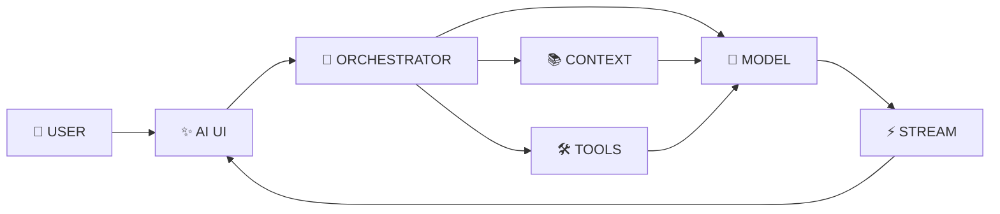
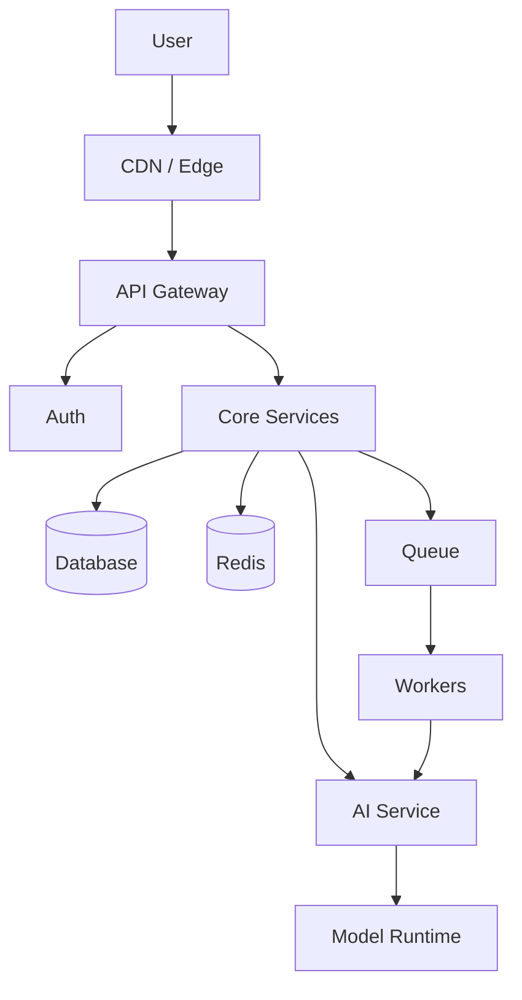

from pathlib import Path

p = Path("/mnt/data/README.md")

sections = []

def section(num, title, accent, emoji, subtitle, body):
    sections.append(f"""
<div align="center">

<table width="100%">
<tr>
<td bgcolor="#080014">

# {emoji} {num:02d} · {title}

### <font color="{accent}">{subtitle}</font>

</td>
</tr>
</table>

</div>

{body}

<div align="center">


</div>

""")

section(1,"WELCOME TO MY DIGITAL UNIVERSE","#00F5FF","🌌",
        "AI • SOFTWARE • MOBILE • SYSTEMS • IMAGINATION",
r'''
<div align="center">


<br>


</div>
''')

section(2,"IDENTITY CORE","#A78BFA","🧬",
        "WHO IS AVINASH?",
r'''
<table width="100%">
<tr>
<td width="55%" bgcolor="#10002B">

```yaml
name: Avinash Pandey
base: India 🇮🇳
role:
  - AI Developer
  - iOS Developer
  - Flutter Developer
  - Full Stack Developer

mission: >
  Build intelligent products that feel simple,
  fast and magical to use.

mindset:
  curiosity: maximum
  learning: continuous
  building: relentless
  imagination: unlimited
```

</td>
<td width="45%" bgcolor="#071A2B">

### ⚡ PERSONAL ENGINE

**Think** → Systems  
**Design** → Experiences  
**Build** → Products  
**Measure** → Results  
**Learn** → Faster  
**Repeat** → Better

</td>
</tr>
</table>
''')

section(3,"NEON PROFILE CARD","#FF2BD6","💎",
        "A PROFILE THAT FEELS LIKE A PRODUCT",
r'''
<div align="center">

<table width="100%">
<tr>
<td bgcolor="#21002E" align="center">🧠<br><b>AI</b><br>Intelligence</td>
<td bgcolor="#001F2E" align="center">📱<br><b>MOBILE</b><br>Experience</td>
<td bgcolor="#2B1020" align="center">🌐<br><b>WEB</b><br>Scale</td>
<td bgcolor="#241300" align="center">⚡<br><b>SYSTEMS</b><br>Architecture</td>
<td bgcolor="#082414" align="center">🚀<br><b>PRODUCT</b><br>Impact</td>
</tr>
</table>

<br>


</div>
''')

section(4,"TECHNOLOGY GALAXY","#00D9FF","🌈",
        "THE STACK BEHIND THE IDEAS",
r'''
<div align="center">

### 🧠 LANGUAGES


### 🎨 FRONTEND


### ⚙️ BACKEND


### 🤖 AI / ML


### ☁️ INFRASTRUCTURE


</div>
''')

section(5,"COLOR ENGINE","#FF7A00","🎨",
        "EVERY SYSTEM NEEDS A VISUAL LANGUAGE",
r'''
<table width="100%">
<tr>
<td bgcolor="#001F26">

### CYAN
`#00F5FF`

Intelligence · Technology · Motion · Future

</td>
<td bgcolor="#260020">

### MAGENTA
`#FF2BD6`

Creativity · Energy · Expression · AI

</td>
<td bgcolor="#21005A">

### VIOLET
`#7C3AED`

Innovation · Research · Imagination

</td>
<td bgcolor="#271000">

### ORANGE
`#FF7A00`

Action · Product · Momentum · Shipping

</td>
</tr>
</table>

> The visual system intentionally moves between cool intelligence and warm human creativity.
''')

section(6,"AI COMMAND CENTER","#7C3AED","🧠",
        "ARTIFICIAL INTELLIGENCE IS THE CORE",
r'''
<div align="center">


</div>

```text
                    ┌─────────────────────┐
                    │    AI APPLICATION    │
                    └──────────┬──────────┘
                               │
             ┌─────────────────┼─────────────────┐
             ▼                 ▼                 ▼
        GENERATIVE          VISION             ML
             │                 │                 │
          LLMs              CNNs            Prediction
          RAG               OCR             Classification
          Agents            Detection       Forecasting
          Tools             Segmentation    Optimization
```
''')

section(7,"AI RESEARCH LAB","#FF2BD6","🔬",
        "EXPERIMENT → MEASURE → IMPROVE",
r'''
<div align="center">

<table width="100%">
<tr>
<td bgcolor="#16001E">🧪<br><b>EXPERIMENT</b><br>Try a hypothesis</td>
<td bgcolor="#001D2A">📊<br><b>MEASURE</b><br>Collect evidence</td>
<td bgcolor="#211040">🧠<br><b>UNDERSTAND</b><br>Find the signal</td>
<td bgcolor="#2B1100">⚡<br><b>OPTIMIZE</b><br>Improve the system</td>
<td bgcolor="#052417">🚀<br><b>SHIP</b><br>Turn research into value</td>
</tr>
</table>

</div>
''')

section(8,"GENERATIVE AI","#C026D3","✨",
        "FROM PROMPT TO INTELLIGENT PRODUCT",
r'''


<div align="center">


</div>
''')

section(9,"COMPUTER VISION","#00E5FF","👁️",
        "TEACHING SOFTWARE TO SEE",
r'''
<table width="100%">
<tr>
<td bgcolor="#001B24">🖼️<br><b>IMAGE</b></td>
<td bgcolor="#082E3A">🔍<br><b>FEATURES</b></td>
<td bgcolor="#123A35">🧠<br><b>MODEL</b></td>
<td bgcolor="#2D1A05">⚡<br><b>INFERENCE</b></td>
<td bgcolor="#27102A">✨<br><b>RESULT</b></td>
</tr>
</table>

### Focus Areas

`Classification` · `Detection` · `Segmentation` · `OCR` · `Restoration` · `Enhancement` · `Tracking`
''')

section(10,"ON-DEVICE AI","#22D3EE","📱",
        "INTELLIGENCE WITHOUT WAITING FOR THE CLOUD",
r'''
```text
PYTORCH / TENSORFLOW
        ↓
MODEL OPTIMIZATION
        ↓
CONVERSION
        ↓
COREML
        ↓
iPHONE / iPAD
        ↓
REAL-TIME INFERENCE
```

<div align="center">


</div>
''')

section(11,"iOS LAB","#FF375F","🍎",
        "SWIFT • SWIFTUI • COREML",
r'''
<div align="center">

</div>

### Architecture

```text
SwiftUI
   ↓
Presentation
   ↓
ViewModel
   ↓
Domain
   ↓
Repository
   ↓
Networking / Local Data
   ↓
Services
```

### Engineering Priorities

**Smooth UI** · **Concurrency** · **Accessibility** · **Performance** · **Offline-first thinking** · **Native feel**
''')

section(12,"FLUTTER LAB","#54C5F8","🦋",
        "ONE CODEBASE • MANY EXPERIENCES",
r'''
<div align="center">

</div>

```text
Flutter
 ├── Presentation
 │    ├── Widgets
 │    ├── Animation
 │    └── Theme
 ├── State
 │    └── Riverpod
 ├── Domain
 │    └── Use Cases
 ├── Data
 │    ├── API
 │    └── Local Storage
 └── AI
      ├── Vision
      └── On-device inference
```
''')

section(13,"WEB EXPERIENCE","#38BDF8","🌐",
        "INTERFACES THAT FEEL ALIVE",
r'''
<div align="center">


</div>

### UI Principles

`Hierarchy` → `Contrast` → `Motion` → `Feedback` → `Delight`

I like interfaces where animation has a purpose instead of being decoration.
''')

section(14,"BACKEND ENGINE","#22C55E","⚙️",
        "THE MACHINERY BEHIND THE EXPERIENCE",
r'''
```text
REQUEST
   ↓
EDGE
   ↓
API GATEWAY
   ↓
AUTH
   ↓
VALIDATION
   ↓
SERVICE
   ↓
DATABASE
   ↓
CACHE / QUEUE
   ↓
RESPONSE
```

<div align="center">

</div>
''')

section(15,"DATABASE MATRIX","#06B6D4","🗄️",
        "DATA IS PART OF THE ARCHITECTURE",
r'''
| SYSTEM | STRENGTH | USE |
|---|---|---|
| 🐘 PostgreSQL | Relational integrity | Core systems |
| 🍃 MongoDB | Flexible documents | Product data |
| 🔥 Firebase | Rapid development | Mobile products |
| ⚡ Redis | Ultra-fast state | Cache / queues |
| 🐬 MySQL | Mature relational DB | Applications |

### Query mindset

`Schema` → `Index` → `Query Plan` → `Cache` → `Measure`
''')

section(16,"CLOUD & DEVOPS","#F97316","☁️",
        "FROM LAPTOP TO PRODUCTION",
r'''
```text
LOCAL
 ↓
GIT
 ↓
PULL REQUEST
 ↓
CI
 ├── TEST
 ├── LINT
 ├── BUILD
 └── SECURITY
 ↓
CONTAINER
 ↓
DEPLOY
 ↓
MONITOR
```

<div align="center">

</div>
''')

section(17,"SYSTEM DESIGN","#A855F7","🏗️",
        "THINK IN SYSTEMS, NOT FILES",
r'''

''')

section(18,"SECURITY","#EF4444","🔐",
        "TRUST IS AN ENGINEERING FEATURE",
r'''
<div align="center">

| 🔑 AUTH | 🛡️ ACCESS | 🔒 DATA | 🚦 RATE LIMIT |
|---|---|---|---|
| Identity | Permissions | Encryption | Abuse control |

</div>

### Security checklist

`Validation` · `Secrets` · `Least Privilege` · `Encryption` · `Logging` · `Monitoring` · `Dependency Hygiene`
''')

section(19,"PERFORMANCE","#F59E0B","⚡",
        "FAST IS A FEATURE",
r'''
```text
USER EXPERIENCE
      ↓
RENDERING
      ↓
NETWORK
      ↓
API
      ↓
CACHE
      ↓
DATABASE
      ↓
COMPUTE
      ↓
AI INFERENCE
```

### Optimization questions

**What is slow?**  
**Why is it slow?**  
**Can it be cached?**  
**Can it be parallelized?**  
**Can it move on-device?**
''')

section(20,"PRODUCT ENGINEERING","#FF2BD6","🚀",
        "IDEA → PRODUCT → IMPACT",
r'''
<div align="center">

<table width="100%">
<tr>
<td bgcolor="#19001F">💡<br><b>IDEA</b></td>
<td bgcolor="#25103B">🔎<br><b>RESEARCH</b></td>
<td bgcolor="#102A3A">🎨<br><b>DESIGN</b></td>
<td bgcolor="#082B1A">🛠️<br><b>BUILD</b></td>
<td bgcolor="#2D1600">🚀<br><b>SHIP</b></td>
<td bgcolor="#241024">📈<br><b>MEASURE</b></td>
</tr>
</table>

</div>
''')

section(21,"FLIGHT BOOKING","#00D9FF","✈️",
        "A MODERN TRAVEL EXPERIENCE",
r'''
```text
SEARCH
  ↓
FLIGHTS
  ↓
FILTER
  ↓
DETAILS
  ↓
PASSENGERS
  ↓
PAYMENT
  ↓
CONFIRMATION
  ↓
TICKET
```

**Stack:** Swift · SwiftUI · APIs · Payment Architecture · State Management
''')

section(22,"AI CHAT APPLICATION","#8B5CF6","💬",
        "CONVERSATION AS A PRODUCT",
r'''
```text
USER
 ↓
MESSAGE
 ↓
CONTEXT
 ↓
AI
 ↓
STREAM
 ↓
MESSAGE UI
 ↓
MEMORY
```

### Experience goals

`Instant feedback` · `Streaming` · `Context` · `Conversation history` · `Useful intelligence`
''')

section(23,"AI PHOTO EDITOR","#EC4899","📸",
        "COMPUTER VISION IN YOUR POCKET",
r'''
```text
PHOTO
 ↓
PREPROCESS
 ↓
AI MODEL
 ↓
DENOISE
 ↓
RESTORE
 ↓
ENHANCE
 ↓
EXPORT
```

### Possible intelligence

**Denoise** · **Restore** · **Upscale** · **Enhance** · **Smart Crop** · **Color Intelligence**
''')

section(24,"SATELLITE AI","#10B981","🛰️",
        "GENERATIVE AI FOR EARTH OBSERVATION",
r'''
```text
SATELLITE IMAGE
      ↓
CLOUD DETECTION
      ↓
MASK GENERATION
      ↓
CONTEXT ANALYSIS
      ↓
RECONSTRUCTION
      ↓
ENHANCEMENT
      ↓
QUALITY CHECK
```

**Research themes:** remote sensing · image reconstruction · generative models · temporal intelligence
''')

section(25,"ORBIX VISION","#38BDF8","🌌",
        "A BROADER SOFTWARE ECOSYSTEM",
r'''
<div align="center">


</div>

### Ecosystem thinking

```text
USER
 ├── Browser
 ├── AI
 ├── Secure Environment
 ├── Developer Tools
 └── Intelligent Services
```

The long-term idea: make complex technology feel simple.
''')

section(26,"SKYAI VISION","#60A5FA","🌍",
        "INTELLIGENT TRAVEL EXPERIENCES",
r'''
```text
DISCOVER
   ↓
UNDERSTAND
   ↓
RECOMMEND
   ↓
PLAN
   ↓
BOOK
   ↓
TRAVEL
   ↓
REMEMBER
```

### Intelligence layer

`Recommendations` · `Itinerary generation` · `Conversational assistant` · `Contextual suggestions`
''')

section(27,"AI PHOTO / VISION LAB","#F472B6","🧪",
        "EXPERIMENTING WITH VISUAL INTELLIGENCE",
r'''
<div align="center">


</div>
''')

section(28,"ENGINEERING WORKFLOW","#14B8A6","🔄",
        "BUILDING WITHOUT LOSING THE BIG PICTURE",
r'''
```text
01  DEFINE THE PROBLEM
02  UNDERSTAND THE USER
03  DESIGN THE SYSTEM
04  PROTOTYPE
05  TEST THE ASSUMPTIONS
06  BUILD THE CORE
07  OBSERVE
08  OPTIMIZE
09  SHIP
10  LEARN
```
''')

section(29,"CODE PHILOSOPHY","#F59E0B","🧩",
        "CODE SHOULD HELP THE NEXT PERSON",
r'''
<div align="center">

| PRINCIPLE | SIGNAL |
|---|---|
| Readability | 🟢 |
| Modularity | 🟢 |
| Testability | 🟢 |
| Observability | 🟢 |
| Performance | 🟡 |
| Simplicity | 🟢 |

</div>

> **If future-me cannot understand it, present-me needs to refactor it.**
''')

section(30,"LEARNING ENGINE","#A78BFA","📚",
        "LEARN BY BUILDING",
r'''
```text
QUESTION
   ↓
RESEARCH
   ↓
BUILD
   ↓
FAIL
   ↓
OBSERVE
   ↓
UNDERSTAND
   ↓
IMPROVE
   ↓
BUILD AGAIN
```

The fastest learning happens when theory meets a real problem.
''')

section(31,"SKILL MATRIX","#22C55E","📊",
        "THE CURRENT ENGINEERING MAP",
r'''
<div align="center">

| DOMAIN | CURRENT FOCUS |
|---|---|
| 🧠 AI / ML | ████████████████████ |
| 🐍 Python | ███████████████████ |
| 🍎 Swift / SwiftUI | ██████████████████ |
| 🦋 Flutter | █████████████████ |
| 🌐 Full Stack | █████████████████ |
| 👁️ Computer Vision | ████████████████ |
| 🏗️ System Design | ██████████████ |
| ☁️ DevOps | █████████████ |

</div>
''')

section(32,"GITHUB TELEMETRY","#00F5FF","📈",
        "THE ACTIVITY SIGNAL",
r'''
<div align="center">


<br><br>


</div>
''')

section(33,"LANGUAGE DNA","#FF2BD6","🧬",
        "WHAT THE CODE IS MADE OF",
r'''
<div align="center">


</div>
''')

section(34,"CONTRIBUTION GALAXY","#7C3AED","🐍",
        "EVERY SQUARE IS A SMALL STORY",
r'''
<div align="center">

<picture>
<source media="(prefers-color-scheme: dark)" srcset="https://raw.githubusercontent.com/avinash9354/avinash9354/output/github-snake-dark.svg">

</picture>

</div>
''')

section(35,"TROPHY WALL","#FFB000","🏆",
        "MILESTONES, NOT DESTINATIONS",
r'''
<div align="center">


</div>
''')

section(36,"ROADMAP","#00F5FF","🗺️",
        "WHERE THE NEXT CHAPTERS LEAD",
r'''
```text
NOW
 │
 ├── AI APPLICATIONS
 ├── iOS / SwiftUI
 ├── Flutter
 ├── Full Stack
 │
 ▼
NEXT
 │
 ├── Advanced AI
 ├── On-device inference
 ├── System design
 ├── Cloud architecture
 │
 ▼
FUTURE
 │
 ├── Original research
 ├── Large-scale AI systems
 ├── Open source
 └── Technology products
```
''')

section(37,"ENGINEERING VALUES","#22C55E","💚",
        "WHAT MATTERS WHEN THE CODE GETS HARD",
r'''
<div align="center">

<table width="100%">
<tr>
<td bgcolor="#062814">🧠<br><b>CURIOSITY</b><br>Ask why.</td>
<td bgcolor="#08251D">🔐<br><b>OWNERSHIP</b><br>Understand the whole.</td>
<td bgcolor="#102A16">✨<br><b>SIMPLICITY</b><br>Reduce the noise.</td>
<td bgcolor="#2B1800">🔥<br><b>RESILIENCE</b><br>Keep iterating.</td>
<td bgcolor="#0A2030">🚀<br><b>IMPACT</b><br>Build useful things.</td>
</tr>
</table>

</div>
''')

section(38,"COMMAND CENTER","#00F5FF","🖥️",
        "TERMINAL VIEW",
r'''
```bash
$ whoami
avinash-pandey

$ focus
AI + Software Engineering + Product Building

$ stack
Swift Python Dart TypeScript Java React Node Flutter PyTorch

$ current_mode
BUILDING

$ philosophy
Learn → Build → Break → Understand → Improve → Ship

$ status
████████████████████████████████████████  ONLINE

$ next
Create something extraordinary.
```

<div align="center">


</div>
''')

section(39,"LET'S BUILD","#FF2BD6","🤝",
        "COLLABORATION IS WHERE IDEAS GET STRONGER",
r'''
<div align="center">

<a href="https://github.com/avinash9354"></a>
<a href="https://www.linkedin.com/in/avinashpandeyai/"></a>
<a href="https://www.instagram.com/mr.avi_pandey/"></a>
<a href="mailto:avinash9354@email.com"></a>

<br><br>

<table width="90%">
<tr>
<td bgcolor="#10002B" align="center">

### 💡 HAVE AN IDEA?

Bring the problem.

</td>
<td bgcolor="#001F2E" align="center">

### 🧠 HAVE A CHALLENGE?

Bring the complexity.

</td>
<td bgcolor="#2B1000" align="center">

### 🚀 HAVE A PRODUCT?

Let's build it.

</td>
</tr>
</table>

</div>
''')

section(40,"FINAL TRANSMISSION","#FF7A00","🌠",
        "THE SYSTEM NEVER STOPS",
r'''
<div align="center">


<br><br>

<table width="100%">
<tr>
<td bgcolor="#001F26" align="center">⚡<br><b>BUILD</b></td>
<td bgcolor="#21002E" align="center">💜<br><b>CREATE</b></td>
<td bgcolor="#241000" align="center">🔥<br><b>SHIP</b></td>
<td bgcolor="#082414" align="center">🌱<br><b>LEARN</b></td>
<td bgcolor="#10104A" align="center">🌌<br><b>IMAGINE</b></td>
</tr>
</table>

<br>

> ## **"The best technology is the technology that makes impossible things feel inevitable."**

<br>


### `SYSTEM STATUS: ONLINE ⚡  •  AI LAB: ACTIVE 🧠  •  FUTURE: LOADING 🚀`

</div>
''')

# Add a visually rich front section and then the 40-page-equivalent portfolio.
front = r'''<div align="center">


<br>


<br><br>


</div>

<div align="center">


</div>

> ### 🌈 **A colorful engineering portfolio — where AI, software, design and imagination meet.**

'''

readme = front + "\n".join(sections)

# Add a compact contents block near the top.
toc = r'''
<div align="center">

## 🧭 NAVIGATION MAP

`01 Identity` · `02 Tech` · `03 AI` · `04 Mobile` · `05 Web` · `06 Backend` · `07 Systems` · `08 Security`  
`09 Performance` · `10 Products` · `11 Projects` · `12 Research` · `13 GitHub` · `14 Roadmap` · `15 Connect`

</div>

---

'''
readme = readme.replace("> ### 🌈 **A colorful engineering portfolio — where AI, software, design and imagination meet.**\n", 
                        "> ### 🌈 **A colorful engineering portfolio — where AI, software, design and imagination meet.**\n\n" + toc, 1)

p.write_text(readme, encoding="utf-8")

print("Created colorful 40-section README")
print("Sections:", len(sections))
print("Lines:", len(readme.splitlines()))
print("Characters:", len(readme))
print("File:", p)
